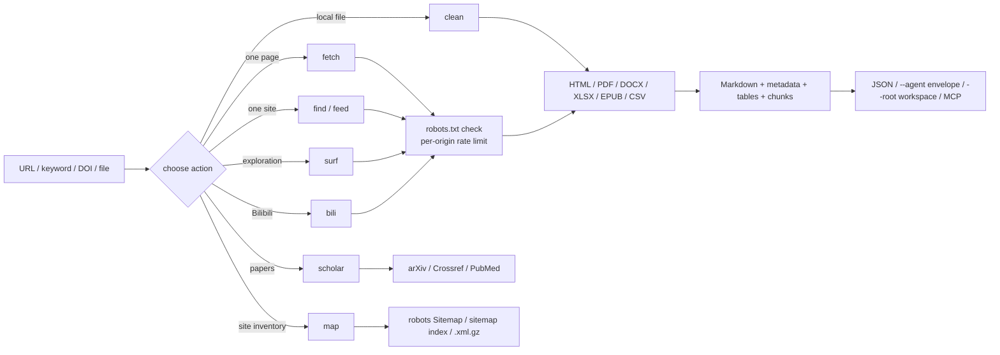

# web-forager

> **A clean-room, robots-aware web information gathering toolkit for agents and analysts: one engine behind a CLI, two MCP servers and a Claude Code skill.**

> ## Disclaimer (read this first)
>
> **This plugin is for learning and information gathering only. Users must comply with the Terms of Service of target websites and applicable copyright law. Malicious concurrent attacks are prohibited. Collecting, aggregating or inferring the personal information of an identifiable individual — or using it for doxxing, harassment, stalking or any other invasion of privacy — is prohibited; the user bears full legal responsibility for such use.**

**English** · [简体中文](README_zh.md)

**Version:** 1.2.1 | **CLI actions:** 9 | **MCP tools:** 10 | **Browser playbooks:** 7

---

## Scope and compliance

The core engine is an original clean-room implementation: no source is copied from Crawlee, Scrapy, Colly, Katana or any other crawling framework, and no GPL/AGPL dependency is used. The tool **never bypasses a login, CAPTCHA, Cloudflare challenge or paywall**, does not run concurrent request floods and does not target personal data. `robots.txt` (RFC 9309 subset) is checked before every target page, each request carries a contactable information-gathering User-Agent, and the default rate is one request per second per origin — search, sitemap and surf hops included. Fetched text comes from third-party sites; this plugin is not responsible for that content or for any consequence of using it.

---

## Two modes, one record

| | HTTP mode | Browser mode |
|---|---|---|
| Reads | what the server returns | what a person sees once scripts run and login state applies |
| Entry points | `run.py`, `mcp_server.py` | `browser/run.js`, `browser/mcp_server.js` |
| Needs | Python 3.10+ | Node.js 18+ and a bridge command |
| Covers | search, HTML/PDF/Office/feeds, sitemaps, surf, Bilibili, scholarly APIs | seven read-only playbooks, rendered pages, danmaku |

Both modes agree on four core fields — `metadata`, `markdown`, `tables` and `warnings` — and extend them differently. `--core` on either CLI, or `core: true` on `browser_run`, folds a record onto one documented shape ([Records](#records)).

Only Bilibili has a site-specific HTTP adapter. Zhihu, Xiaohongshu, Weibo and Douban are read as ordinary pages in HTTP mode; Zhihu and Xiaohongshu add browser playbooks, and Weibo and Douban have none.

---

## How a run flows

Every request enters through the same `HttpFetcher`: robots policy, cache, retry/backoff, per-origin rate limiter and size cap. The chosen action then routes the payload to the matching extractor, and all extractors converge on the same Markdown plus metadata record.



`surf` only follows `<a href>` links that already exist in the page; it never constructs guessed URLs, submits forms or executes page JavaScript. `map` reads only published sitemaps, and `scholar` calls documented APIs instead of scraping result pages.

Browser mode is a second loop beside this one: the bridge supplies a page, `browser/run.js` reads a DOM snapshot, the session decides what is new, the playbook picks the next navigation step and a capture is written. Only one state-changing action runs per observation cycle, and write-like controls are denied by default.

---

## Installation

Install it as one plugin: the CLI, both MCP servers and `SKILL.md` share a single engine, so splitting the tree breaks it.

### Method 1: install from the plugin marketplace by URL

Every host below has its own plugin marketplace. Register this repository's Git URL, then install the plugin it lists (registering the URL twice is harmless — the second call reports it is already known).

```bash
https://github.com/JiamingShi-JsPhys/web-forager
```

### Method 2: install with commands

Claude Code, Codex, dsh and CodeBuddy take a one-line plugin command; Cursor, Windsurf, Cline, Continue, Roo Code, GitHub Copilot and opencode read a rule file, and one script writes all of them. Every command, every flag and the optional dependencies live on one page: **[docs/INSTALL_COMMANDS.md](docs/INSTALL_COMMANDS.md)**.

### Method 3: let your AI install it

```bash
Please visit the GitHub repository `https://github.com/JiamingShi-JsPhys/web-forager` and clone it, then run `python install.py --project . --global`. If your host has a plugin system, install it as a single plugin instead; the script covers the hosts that read rule files.
```

> **Warning**: when an AI performs the installation it will very likely scatter `scripts/`, `run.py` and `SKILL.md` into unrelated folders. The modules import each other and the MCP server assumes the plugin-relative layout, so a scattered copy stops working. Use Method 1 if you need the full plugin.

---

## Quick start

Install the plugin, then stay in the chat box: type `/` and pick a skill or a command. No shell, no absolute path — the folder you are working in is the workspace.

### Skills

The skill is registered under the `web-forager` namespace, so it is one `/` away:

```text
/web-forager:web-forager  collect https://www.bilibili.com/video/BV1xx411c7mD as Markdown
```

Say what you want after the name; the skill picks the action and returns Markdown, metadata, tables and warnings. A page that robots.txt disallows is refused, not fetched.

### Commands

| Command | Does |
|---|---|
| `/web-forager:fetch` | Fetches one URL, or searches a keyword and reads the results |
| `/web-forager:surf` | Searches or opens a seed URL, then follows ranked in-page links with a resumable session |
| `/web-forager:scholar` | Queries arXiv, Crossref or PubMed, or resolves a DOI |
| `/web-forager:map` | Discovers page URLs from robots.txt Sitemap lines, sitemap indexes and `.xml.gz` files |
| `/web-forager:browse` | Runs a read-only browser playbook through the browser MCP server |

```text
/web-forager:fetch https://example.org/article
/web-forager:scholar 10.1038/nature14539
```

### When the engines are blocked

Search defaults to `auto`. A mostly-CJK query goes to 360, Sogou and Sogou WeChat — the article index is the one channel that normally carries a Chinese person's or institution's name — and is not handed to Bing, which splits such a phrase into single characters and answers with dictionary pages. Those pages are dropped from any engine's results. An agent that wants Bing for a Chinese query can still ask with `--engine bing`.

Two routes need no search engine at all:

```bash
python run.py --action find --site the-decoder.com --query "OpenAI watermark" --max-pages 3
python run.py --action feed --url https://the-decoder.com/ --num-results 10
```

`find` tries the site's own search URLs (`/?s=`, `/search?q=` and two more), ranks the links by the query and fetches the best ones. `feed` discovers the site's RSS/Atom `<link rel=alternate>` and reads it. `doctor --probe` asks every engine once and reports which ones answer from this network; `doctor` also reports the proxy in use with its credentials removed. Requests honour `HTTPS_PROXY` / `ALL_PROXY`, and `--proxy URL` overrides them for one run.

### Browser mode

The browser layer lives in `browser/` and needs Node.js 18 or newer. It is read-only by default: like, coin, favourite, follow, share, comment, danmaku and publish are denied unless `--allow-write` is passed after the user authorises that single action.

```bash
node browser/run.js --list
node browser/run.js --doctor
node browser/run.js --playbook bili-feed --session bili-01 --max-items 8 --agent
node browser/run.js --playbook bili-video --url "https://www.bilibili.com/video/BV1xx411c7mD"
node browser/run.js --playbook zhihu-dig --query "reinforcement learning" --agent
node browser/run.js --playbook bili-feed --dry-run
```

| Playbook | Does | Requires |
|---|---|---|
| `bili-feed` | Home feed, scroll and capture unseen cards | none |
| `bili-video` | One video and its visible comments | `--url` or `--bvid` |
| `bili-chain` | Follow the next-episode control and resume from the session | `--url`, `--bvid`, or a chain |
| `bili-danmaku` | Timestamped danmaku, preferring bridge `observe` over DOM text (experimental) | `--url` or `--bvid` |
| `zhihu-dig` | Zhihu search, rank links, capture the best unseen page | `--query` |
| `xhs-dig` | Xiaohongshu public notes, rank `/explore` links, capture one | `--query` |
| `search-dig` | Bilibili search, rank cards, open the best unseen result | `--query` |

The bundled bridge is picked up automatically once `playwright` and its Chromium binary are installed; `--bridge` or `WEB_FORAGER_BRIDGE` points at a bridge elsewhere:

```bash
npm install playwright && npx playwright install chromium
node browser/run.js --playbook bili-feed --doctor   # says what is still missing
```

`WEB_FORAGER_BROWSER_HEADFUL=1` shows the window, `WEB_FORAGER_BROWSER_PROFILE=/path` reuses a persistent profile (this is what carries login state for the `extension` backend), and `WEB_FORAGER_BROWSER_CDP=http://127.0.0.1:9222` attaches to a browser you already control (`cdp`). A bridge declares its real capabilities through an optional `describe` call; one that does not implement it is reported as `declared: false` with every capability false.

`--strict-robots` fetches `robots.txt` before every navigation and stops with `robots_denied` (exit 3) on a disallowed path. Without it the record says so: `compliance.robots_checked` is `false`. A run that reaches the site but finds nothing readable is `degraded` (exit 8) with its records attached; an anti-bot or error interstitial is `blocked` (exit 9); a site that asks for credentials is `login_required` (exit 6).

A browser run is the most expensive thing the plugin does, so its defaults are small: records go to disk with `--out result.json` (or `out:` in MCP), no screenshots are taken unless asked, `--max-screens 5` and `--min-interval 3000` keep a walk polite, and a long walk is better split into runs that resume from `--session`.

### MCP servers

```json
{
  "mcpServers": {
    "web-forager": {
      "command": "python",
      "args": ["/absolute/path/to/web-forager/mcp_server.py"]
    },
    "web-forager-browser": {
      "command": "node",
      "args": ["/absolute/path/to/web-forager/browser/mcp_server.js"]
    }
  }
}
```

HTTP tools: `web_fetch`, `web_search`, `web_surf`, `web_scholar`, `web_map`, `web_bilibili`, `web_clean`, `web_doctor`, `web_find`, `web_feed`. Browser tools: `browser_list`, `browser_run`, `browser_session`, `browser_doctor`.

Two switches keep a search cheap: `max_pages: 0` returns the result list with no page bodies (fetch one with `web_fetch` and a small `max_chars`), and `respect_robots: false` reads a page robots.txt disallows, only for resources you are authorised to read. `web_search` also returns `engine_report` — one entry per engine tried — and `warnings` when the results do not mention the query.

Test the protocol directly:

```bash
printf '%s\n' '{"jsonrpc":"2.0","id":1,"method":"initialize","params":{}}' \
  '{"jsonrpc":"2.0","id":2,"method":"tools/list"}' | python mcp_server.py
```

```bash
printf '%s\n' '{"jsonrpc":"2.0","id":1,"method":"initialize","params":{}}' \
  '{"jsonrpc":"2.0","id":2,"method":"tools/list"}' | node browser/mcp_server.js
```

### CLI examples

```bash
python run.py --action fetch --url "https://www.bilibili.com/video/BV1xx411c7mD"
python run.py --action fetch --url "https://www.zhihu.com/" --render auto
python run.py --action fetch --query "city walk guide" --num-results 8 --max-pages 3
python run.py --action surf --url "https://www.zhihu.com/" --depth 1 --max-pages 5 --session zhihu-01
python run.py --action clean --input notes.pdf --format markdown
python run.py --action map --url "https://example.org" --limit 500
python run.py --action bili --mode feed --max-items 10
```

### Workspace output

```bash
python run.py --action fetch --url "https://example.org/article" --root <WS>
```

Writes only:

```text
<WS>/process/web-forager/web-forager_<timestamp>_<slug>.json
<WS>/process/web-forager/web-forager_<timestamp>_<slug>.md
<WS>/_broadcast/web-forager_<timestamp>_<slug>.json
```

`material/` and `results/` belong to the user and the orchestrator; web-forager never writes there. Browser captures follow the same discipline under `<WS>/process/web-forager/browser/` and `<WS>/_broadcast/`.

### Records

| Field | HTTP mode | Browser mode |
|---|---|---|
| `metadata`, `markdown`, `tables`, `warnings` | yes | yes |
| `url`, `title` | yes (`url` and `final_url`) | yes |
| `status`, `content_type`, `document_kind`, `cached`, `rendered`, `fetched_at`, `chunks`, `links` | yes | no |
| `schema_version`, `captured_at`, `playbook`, `backend`, `compliance`, `viewport_evidence`, `interaction_trace` | no | yes |

`--core` returns the shared shape instead:

```json
{
  "schema_version": "core-1",
  "source": "web-forager",
  "mode": "http",
  "url": "https://example.org/article",
  "title": "An article",
  "collected_at": "2026-11-07T10:00:00Z",
  "metadata": {},
  "markdown": "...",
  "tables": [],
  "warnings": [],
  "extra": { "status": 200, "cached": false }
}
```

`mode` is `http` or `browser`, `source` names the producer, and `extra` keeps every field the two modes do not share. The same fold is available as a library call: `engine.normalize_record()` in Python and `normalizeRecord()` in `browser/lib/record.js`.

`results` is an index, not a second copy of every page. For a search it carries `url`, `title`, `snippet`, `status`, `content_type`, `markdown_chars`, `tables` and any `warnings` or `error`; the Markdown body lives once, in `pages`, and a single `fetch` keeps it at the top level. `--full-results` (CLI) or `fullResults: true` (MCP) restores the old shape.

---

## Actions and exit codes

| Action | Purpose |
|---|---|
| `fetch` | one URL or keyword query → pages |
| `find` | search inside one site through the site's own search page |
| `feed` | read a site's RSS/Atom feed, discovering it from the page |
| `clean` | local or remote HTML/PDF/DOCX/XLSX/EPUB/CSV → Markdown |
| `bili` | Bilibili feed / video / related / search / surf |
| `surf` | search or seed URL, then ranked link BFS |
| `scholar` | arXiv / Crossref / PubMed / DOI records |
| `map` | page URLs from robots.txt and sitemaps |
| `doctor` | dependency report: what is installed, what to install |

| Exit code | Meaning |
|---|---|
| 0 | success |
| 2 | argument or URL error |
| 3 | robots.txt denied the request |
| 4 | network / HTTP failure |
| 5 | extraction failed |
| 6 | Playwright requested but unavailable |
| 7 | PDF requested but `pypdf` unavailable |
| 130 | interrupted |

Browser mode reuses those codes where the meaning carries over and adds its own:

| Exit code | Browser meaning |
|---|---|
| 2 | argument error, or an unknown backend |
| 3 | `robots_denied` under `--strict-robots`, or no bridge configured |
| 4 | navigation failed |
| 5 | capture failed |
| 6 | `login_required`: the site asked for credentials |
| 7 | `confirmation_required`: a write-like action was denied |
| 8 | `degraded`: the page was read, but the playbook found nothing it looks for |
| 9 | `blocked`: an anti-bot or error interstitial replaced the page |
| 130 | interrupted |

`--agent` keeps these exit codes and prints a `{"ok":false,"error":{"code","message","hint"}}` envelope on stdout. `doctor` reports every dependency with its version or the command that installs it; a missing Playwright returns exit code 6, and a missing `pypdf` returns exit code 7.

---

## Requirements

Python 3.10+. Core runtime: `requests`, `beautifulsoup4`, `trafilatura`. Optional: `playwright` (JS rendering), `pypdf` (PDF). `defusedxml` is used when already installed but is never required — XML with an internal DTD subset or any ENTITY declaration is rejected regardless. Browser mode additionally needs Node.js 18+ and a bridge command; `browser/bridges/playwright-bridge.js` needs `playwright` installed with npm. No third-party code is vendored; the full per-capability matrix lives in [docs/DEPENDENCIES.md](docs/DEPENDENCIES.md).

---

## Repository layout

```text
web-forager/
├── .claude-plugin/               Claude Code manifest + marketplace
├── .codex-plugin/                Codex manifest + marketplace
├── .codebuddy-plugin/            CodeBuddy manifest + marketplace
├── .dsh-plugin/                  DSH manifest + CJS entry
├── .cursor/rules/                Cursor rule file
├── .windsurf/rules/              Windsurf rule file
├── .clinerules/                  Cline rule file
├── .continue/rules/              Continue rule file
├── .roo/rules/                   Roo Code rule file
├── .github/                      Copilot instructions + Actions CI
├── AGENTS.md                     generic agent contract
├── install.py                    one-command rule-file installer
├── manifest.json                 plugin manifest
├── .mcp.json                     MCP stdio registration
├── package.json / index.js       npm + dsh packaging
├── cordis.patch.yml              dsh bundle patch
├── run.py                        CLI: nine actions
├── mcp_server.py                 MCP stdio server (10 HTTP tools)
├── browser/                      browser mode (Node 18+)
│   ├── run.js                    CLI: seven read-only playbooks
│   ├── mcp_server.js             MCP stdio server (4 browser tools)
│   ├── lib/                      bridge backend, session, record, safety, selectors, robots, snapshot
│   ├── playbooks/                bili-* / zhihu-dig / xhs-dig / search-dig
│   ├── bridges/                  optional Playwright reference bridge
│   └── tests/                    fake backends, real-page snapshots, live smoke
├── SKILL.md                      Claude Code skill contract
├── commands/                     /fetch /surf /scholar /map /browse
├── docs/                         install commands, acknowledgements, dependency matrix
├── scripts/
│   ├── engine.py                 robots, fetch, search, cache, chunks, Markdown, surf, find, feed
│   ├── pdf.py                    PDF text (optional pypdf)
│   ├── documents.py              DOCX / XLSX / EPUB / CSV
│   ├── feeds.py                  RSS / Atom / RSS 1.0
│   ├── scholar.py                arXiv / Crossref / PubMed / DOI
│   ├── sitemap.py                sitemap discovery
│   └── bilibili.py               Bilibili adapter
├── tests/                        offline HTTP fixtures
├── requirements.txt
├── THIRD_PARTY_LICENSES.txt
├── CHANGELOG.md
├── README.md · README_zh.md
└── LICENSE                       MIT
```

---

## Tests

```bash
python -m pytest tests -q
npm run test:browser
```

That is **174 Python tests** plus **60 browser tests**, all passing and fully offline. `conftest.py` starts a temporary local HTTP server serving robots.txt, articles, PDF/Office files, feeds, sitemaps, search-result pages, a site-search page and multi-hop surf pages. The Python suite covers robots denial, extraction, tables, documents, feeds, cache, search pagination and routing, chunking, MCP, surf sessions, installer behaviour, host-rule and disclaimer checks, the shared `core-1` record, and every exit code. The browser suite uses a fake backend plus fake bridges that speak the wire protocol, so the CLI runs end to end without a browser; it covers capability declaration, robots.txt matching, the `--strict-robots` round trip, and the degraded and blocked paths over snapshots recorded from live pages.

CI runs both suites on every push to `main`, on pull requests and on version tags: Python on Ubuntu 3.10/3.12 and Windows 3.12, browser mode on Node 20/22. A live check is opt-in and never runs in CI:

```bash
WEB_FORAGER_LIVE=1 WEB_FORAGER_BRIDGE="node browser/bridges/playwright-bridge.js" npm run test:live
```

---

## Known limitations

- **This is a low-frequency tool, not a crawler fleet**: requests are serial and rate-limited per origin (one per second by default), and `surf`, search and sitemap reads do not fan out concurrently. It is unsuitable for large-scale harvesting.
- **PDF extraction reads the text layer only**: scanned PDFs need OCR, which this plugin does not do.
- **Scholarly APIs return metadata and abstracts**: they do not return full papers; respect each platform's terms.
- **`--render auto` is a heuristic**: short visible text plus SPA markers. Complex sites may need `--render always`, and `--wait-for` / `--scroll` only work when Playwright is installed.
- **Search depends on public result pages**: availability varies by network, and every parser (`parse_360_html`, `parse_bing_html`, `parse_sogou_html`, `parse_weixin_html`, `parse_ddg_html`) encodes an assumption about the result-page markup. Each has an offline fixture under `tests/fixtures/`; a redesign breaks the fixture test rather than silently returning nothing. **Baidu is not supported**: its result page is heavily guarded and no parser is shipped. Sogou may show a human-verification page, and `--engine all` can fail partially. A Chinese query never falls back to Bing, and dictionary pages that match one character of a query are dropped.
- **Only Bilibili has a site-specific HTTP adapter**: the other sites named above are read as ordinary pages, which is enough for public article pages and not enough for logged-in feeds.
- **Browser mode needs a working bridge**: `playwright` and its Chromium binary are installed separately, `--doctor` names whichever is missing, and with no bridge at all a live run exits 3.
- **Browser selectors are heuristics**: every pattern about a third-party page lives in `browser/lib/selectors.js` and is regression-tested against snapshots derived from live pages (`browser/tests/fixtures/snapshots/`, recorded 2026-11-07). That catches drift after the fact, not before it; `npm run test:live` re-checks the live sites when you set `WEB_FORAGER_LIVE=1` and a bridge.
- **Danmaku is experimental**: bridge `observe("danmaku", ms)` is preferred; DOM text is a fallback that assumes one visible `mm:ss text` layout, and the record says so in its warnings. Canvas-rendered text still needs OCR.
- **Login walls are not bypassed**: `zhihu-dig` and `xhs-dig` stop with `login_required`; reuse a logged-in profile through your bridge.
- **`surf` follows ordinary links only**: it does not click buttons, execute JavaScript or handle login walls.
- **robots.txt unreachable means deny**: that is the conservative RFC behaviour. `--ignore-robots` is only for resources you are explicitly authorised to access. Browser mode consults robots.txt only under `--strict-robots`; the record always states whether the check was made (`compliance.robots_checked`).

---

## Report issues

**Regular bugs / feature requests**: file them on the repository's [Issues](https://github.com/JiamingShi-JsPhys/web-forager/issues) page. Include reproduction steps, expected behaviour, actual behaviour, and the environment (operating system, Python version).

**Security vulnerabilities (this category only)**: do **not** use the public Issues page. Email `jiamingshi_git@outlook.com` instead.

- **Subject**: must carry the prefix `report_web-forager:` plus a short summary.
  - Example: `report_web-forager: path traversal can read outside the target folder`
- **Body**: must include detailed reproduction steps and the environment.

*Contributors who file clear, reproducible issues or pull requests are credited in the next release's notes and in [Acknowledgements](#acknowledgements).*

## Acknowledgements

NotFatJustRound

[Full acknowledgements](docs/ACKNOWLEDGEMENTS.md)

## Trademarks

"Bilibili", "arXiv", "Crossref", "PubMed", "Claude", "Codex", "CodeBuddy" and "DeepSeek" are trademarks or registered trademarks of their respective owners. web-forager is an independent, third-party tool. It is not affiliated with, endorsed by, or sponsored by any of them. All requests go to public pages or documented APIs; users are responsible for complying with each platform's terms.

---

## License

MIT. See [LICENSE](LICENSE) and [THIRD_PARTY_LICENSES.txt](THIRD_PARTY_LICENSES.txt).

**Author & Maintainer**: Jiaming Shi
