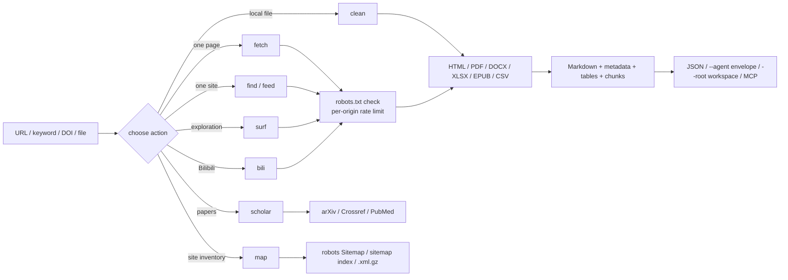

# web-forager

**Read the public web politely, and hand the result to an agent as clean Markdown.**

One engine behind three front doors — a CLI, two MCP servers and a Claude Code skill. It searches 360 / Bing / Sogou / Sogou WeChat, reads HTML, PDF, Office files, ebooks, feeds and sitemaps, drives a real browser for rendered or login-state sites, and refuses what it should not touch.

- **For agents:** a stable `{"ok":…}` envelope, `--core` records shared by both modes, and `trust: "untrusted"` on every piece of third-party text.
- **For people:** one command per task, Markdown with tables, and a record that says what was skipped and why.
- **For compliance:** robots.txt on every HTTP request, a per-origin rate limit, private addresses refused, and no login or CAPTCHA bypass.

**English** · [简体中文](README_zh.md)

**Version:** 1.2.2 | **License:** MIT | **Python:** 3.10+ | **Node:** 18+ (browser mode)

> For learning and information gathering only. Read the [full legal notice](#full-legal-notice) before use.

---

## Contents

**Getting started**

- [Why web-forager](#why-web-forager)
- [Install](#installation)
- [Quick start](#quick-start)

**How it works**

- [Two modes, one record](#two-modes-one-record)
- [How a run flows](#how-a-run-flows)
- [Full reference](#full-reference)
- [Security boundaries](#security-boundaries)
- [Scope and compliance](#scope-and-compliance)
- [Full legal notice](#full-legal-notice)

**The rest**

- [Known limitations](#known-limitations)
- [Report issues](#report-issues)
- [Acknowledgements](#acknowledgements)
- [Trademarks](#trademarks)
- [License](#license)

---

## Why web-forager

A search API usually returns links and stops. A scraper usually reads pages and ignores the rules. An agent needs both halves plus a contract it can trust; this project puts them in one engine.

- **One engine, every content type.** HTML, PDF, DOCX, XLSX, EPUB, CSV, RSS/Atom, sitemaps, Bilibili and rendered pages all come back as the same four fields — `metadata`, `markdown`, `tables`, `warnings` — so the caller never branches on the source.
- **Compliance is inside the fetcher.** robots.txt, per-origin delay, response size caps, redirect limits and a contactable User-Agent apply to every request, including each search, sitemap and surf hop.
- **It degrades instead of crashing.** A missing bridge is exit 3, missing Playwright is exit 6, missing `pypdf` is exit 7, a site without a sitemap is an empty result with a note, and every record says what was skipped.
- **It tells the truth about what it read.** `engine_report` names every engine tried, `degraded` means the page was read but the playbook found nothing, and fetched text carries `trust: "untrusted"` with `injection_flags` when it looks like a prompt.

---

## Installation

Install it as one plugin: the CLI, both MCP servers and `SKILL.md` share a single engine, so splitting the tree breaks it.

**Most people should use Method 1: let your AI install it.** Use Method 2 if your host has a plugin marketplace and you prefer to register the URL yourself; use Method 3 if you install from a terminal or onto several hosts at once.

### Method 1: let your AI install it

```bash
Please visit the GitHub repository `https://github.com/JiamingShi-JsPhys/web-forager` and clone it, then run `python install.py --project . --global`. If your host has a plugin system, install it as a single plugin instead; the script covers the hosts that read rule files.
```

### Method 2: install from the plugin marketplace by URL

Every host below has its own plugin marketplace. Register this repository's Git URL, then install the plugin it lists (registering the URL twice is harmless — the second call reports it is already known).

```bash
https://github.com/JiamingShi-JsPhys/web-forager
```

### Method 3: install with commands

Claude Code, Codex, dsh and CodeBuddy take a one-line plugin command; Cursor, Windsurf, Cline, Continue, Roo Code, GitHub Copilot and opencode read a rule file, and one script writes all of them. Every command, every flag and the optional dependencies live on one page: **[docs/INSTALL_COMMANDS.md](docs/INSTALL_COMMANDS.md)**.

---

## Quick start

Three ways in, plus an optional browser mode. Pick the one that matches where you already are.

> If you read only three tables, read the [command table](#from-the-chat-no-shell-no-path), the [action table](docs/REFERENCE.md#actions-and-exit-codes) and the [exit-code table](docs/REFERENCE.md#actions-and-exit-codes).

### From the chat (no shell, no path)

The skill is registered under the `web-forager` namespace, so it is one `/` away:

```text
/web-forager:web-forager  collect https://www.bilibili.com/video/BV1xx411c7mD as Markdown
```

Say what you want after the name; the skill picks the action and returns Markdown, metadata, tables and warnings. A page that robots.txt disallows is refused, not fetched.

Five commands cover the usual jobs:

| Command | Does |
|---|---|
| `/web-forager:fetch` | Fetches one URL, or searches a keyword and reads the results |
| `/web-forager:surf` | Searches or opens a seed URL, then follows ranked in-page links with a resumable session |
| `/web-forager:scholar` | Queries arXiv, Crossref or PubMed, or resolves a DOI |
| `/web-forager:map` | Discovers page URLs from robots.txt Sitemap lines, sitemap indexes and `.xml.gz` files |
| `/web-forager:browse` | Runs a read-only browser playbook through the browser MCP server |

```text
/web-forager:fetch https://example.org/article
/web-forager:scholar 10.1038/nature14539
```

### From a terminal

Install the dependencies once:

```bash
pip install -r requirements.txt
```

One page, as Markdown + metadata + tables:

```bash
python run.py --action fetch --url "https://example.org/article"
```

Search, then read the top results:

```bash
python run.py --action fetch --query "city walk guide" --num-results 8 --max-pages 3
```

A paper, without touching a result page:

```bash
python run.py --action scholar --source doi --query "10.1038/nature14539"
```

Search defaults to `auto`; a mostly-CJK query goes to 360, Sogou and Sogou WeChat. If the engines are blocked, the [full reference](docs/REFERENCE.md#when-the-engines-are-blocked) shows the site-search and feed routes that need no engine.

Not sure which action you need?

| You have | Use |
|---|---|
| one URL or a keyword | `--action fetch` |
| a site you trust, no working search engine | `--action find --site <HOST> --query <TEXT>` |
| a blog or news site | `--action feed --url <SITE>` |
| a PDF, DOCX, XLSX, EPUB or CSV | `--action clean --input <FILE>` |
| a topic to explore link by link | `--action surf --query <TEXT>` |
| a DOI, arXiv id or paper title | `--action scholar` |
| a site whose pages you want to enumerate | `--action map --url <SITE>` |
| Bilibili | `--action bili` |
| "why is this not working" | `--action doctor [--probe]` |

Add `--agent` to any of them for a machine-readable `{"ok":true,"data":…}` envelope. Add `--out result.json` to keep the full record on disk, or `--root <WS>` to write it into a workspace (see [records and output](docs/REFERENCE.md#records-and-output)).

### From an MCP client

```json
{
  "mcpServers": {
    "web-forager": {
      "command": "python",
      "args": ["/absolute/path/to/web-forager/mcp_server.py"]
    },
    "web-forager-browser": {
      "command": "node",
      "args": ["/absolute/path/to/web-forager/browser/mcp_server.js"]
    }
  }
}
```

Two switches keep a search cheap: `max_pages: 0` returns the result list with no page bodies (fetch one with `web_fetch` and a small `max_chars`), and `respect_robots: false` reads a page robots.txt disallows, only for resources you are authorised to read. `web_search` also returns `engine_report` — one entry per engine tried — and `warnings` when the results do not mention the query.

### Browser mode (optional)

Needs Node.js 18+ and a bridge command, and is read-only by default. The seven playbooks, their switches, `--strict-robots` and the cost controls are in the [full reference](docs/REFERENCE.md#browser-mode).

---

## Two modes, one record

| | HTTP mode | Browser mode |
|---|---|---|
| Reads | what the server returns | what a person sees once scripts run and login state applies |
| Entry points | `run.py`, `mcp_server.py` | `browser/run.js`, `browser/mcp_server.js` |
| Needs | Python 3.10+ | Node.js 18+ and a bridge command |
| Covers | search, HTML/PDF/Office/feeds, sitemaps, surf, Bilibili, scholarly APIs | seven read-only playbooks, rendered pages, danmaku |

Both modes agree on four core fields — `metadata`, `markdown`, `tables` and `warnings` — and extend them differently. `--core` on either CLI, or `core: true` on `browser_run`, folds a record onto one documented shape ([records and output](docs/REFERENCE.md#records-and-output)).

Only Bilibili has a site-specific HTTP adapter. Zhihu, Xiaohongshu, Weibo and Douban are read as ordinary pages in HTTP mode; Zhihu and Xiaohongshu add browser playbooks, and Weibo and Douban have none.

---

## How a run flows

Every request enters through the same `HttpFetcher`: robots policy, cache, retry/backoff, per-origin rate limiter and size cap. The chosen action then routes the payload to the matching extractor, and all extractors converge on the same Markdown plus metadata record.



`surf` only follows `<a href>` links that already exist in the page; it never constructs guessed URLs, submits forms or executes page JavaScript. `map` reads only published sitemaps, and `scholar` calls documented APIs instead of scraping result pages.

Browser mode is a second loop beside this one: the bridge supplies a page, `browser/run.js` reads a DOM snapshot, the session decides what is new, the playbook picks the next navigation step and a capture is written. Only one state-changing action runs per observation cycle, and write-like controls are denied by default.

---

## Full reference

Records, the full action list, exit codes, requirements, repository layout and test details live in **[docs/REFERENCE.md](docs/REFERENCE.md)**, so this page can stay a quick start.

The codes you will meet first: exit code 3 is a robots.txt refusal, exit code 6 is missing Playwright (or a login wall in browser mode), exit code 7 is missing `pypdf`, exit code 8 means the page was read but nothing was captured, and exit code 9 means an anti-bot page replaced the content. The full tables are in the reference.

---

## Security boundaries

The tool makes the requests a prompt or an agent asks for, so three boundaries are built in rather than left to the caller.

- **Private targets are refused.** Loopback, RFC 1918, link-local (including `169.254.169.254`), CGNAT and their IPv6 forms are rejected before a socket opens, and again on every redirect hop, so a public URL cannot bounce the client into the LAN. `--allow-private` exists for local fixtures and trusted intranet tools and is off by default.
- **The browser keeps its own profile.** The bundled bridge stores state under `~/.web-forager/browser/profile`, not in the browser you use every day. Attaching over CDP to a personal browser still works, but the run is marked `shared_browser: true` with a warning: every cookie and login in that profile is reachable by the pages a playbook opens. The bridge also blocks page-initiated requests to private addresses, so a hostile page cannot probe `http://127.0.0.1:…` from inside the browser.
- **Fetched text is data, and says so.** Every record carries `trust: "untrusted"`. When a page contains instruction-shaped text — "ignore previous instructions", fake system tags, `curl … | sh`, requests to send keys or environment variables — the matching codes appear in `injection_flags` and a warning sits first in the list. `--input-gate strict` withholds the body instead. This is a screen, not a sandbox: the host must still keep untrusted content, private data and outbound requests out of one autonomous loop.

---

## Scope and compliance

The core engine is an original clean-room implementation: no source is copied from Crawlee, Scrapy, Colly, Katana or any other crawling framework, and no GPL/AGPL dependency is used. The tool **never bypasses a login, CAPTCHA, Cloudflare challenge or paywall**, and it does not run concurrent request floods. `robots.txt` (RFC 9309 subset) is checked before every target page, each request carries a contactable information-gathering User-Agent, and the default rate is one request per second per origin — search, sitemap and surf hops included.

---

## Full legal notice

### What this tool is for

web-forager automates reading publicly reachable pages, for learning, research, monitoring and personal knowledge work only.

### What it must not be used for

- Identifying, locating, profiling or contacting a private individual, or assembling scattered records into a picture of a person.
- Harassment, stalking, intimidation, doxxing, or any invasion of another person's privacy.
- Bypassing logins, CAPTCHAs, paywalls or access controls, or placing load on a site beyond the built-in rate limit.
- Sending malicious concurrent requests, or any denial-of-service-style access, to a target site.
- Any use that breaks the law where you are, or the terms of the site you are reading.

### Your responsibility

It is the end user's responsibility to obey all applicable local, state and federal laws and the Terms of Service and copyright of every site reached. The authors do not grant permission to access anything you are not entitled to read, and do not verify that a given use is lawful. The user bears full legal responsibility for how this software is used.

### No warranty

The software is provided "as is", without warranty of any kind, express or implied, as stated in the [MIT License](LICENSE). It may fail, return incomplete or outdated content, or change behaviour between versions.

### Limitation of liability

To the maximum extent permitted by law, the authors and contributors assume no liability and are not responsible for any misuse of this software or for any damage, loss or legal consequence arising from it. Fetched text comes from third-party sites and is not endorsed or checked by this project.

### If you redistribute it

Keep this disclaimer and the licence notice with any copy you publish or fork.

---

## Known limitations

### Read before use

- **This is a low-frequency tool, not a crawler fleet**: requests are serial and rate-limited per origin (one per second by default), and `surf`, search and sitemap reads do not fan out concurrently. It is unsuitable for large-scale harvesting.
- **PDF extraction reads the text layer only**: scanned PDFs need OCR, which this plugin does not do.
- **Login walls are not bypassed**: `zhihu-dig` and `xhs-dig` stop with `login_required`; reuse a logged-in profile through your bridge.
- **robots.txt unreachable means deny**: that is the conservative RFC behaviour. `--ignore-robots` is only for resources you are explicitly authorised to access. Browser mode consults robots.txt only under `--strict-robots`; the record always states whether the check was made (`compliance.robots_checked`).

### Edge cases

- **Scholarly APIs return metadata and abstracts**: they do not return full papers; respect each platform's terms.
- **`--render auto` is a heuristic**: short visible text plus SPA markers. Complex sites may need `--render always`, and `--wait-for` / `--scroll` only work when Playwright is installed.
- **Search depends on public result pages**: availability varies by network, and every parser (`parse_360_html`, `parse_bing_html`, `parse_sogou_html`, `parse_weixin_html`, `parse_ddg_html`) encodes an assumption about the result-page markup. Each has an offline fixture under `tests/fixtures/`; a redesign breaks the fixture test rather than silently returning nothing. **Baidu is not supported**: its result page is heavily guarded and no parser is shipped. Sogou may show a human-verification page, and `--engine all` can fail partially. A Chinese query never falls back to Bing, and dictionary pages that match one character of a query are dropped.
- **Only Bilibili has a site-specific HTTP adapter**: the other sites named above are read as ordinary pages, which is enough for public article pages and not enough for logged-in feeds.
- **Browser mode needs a working bridge**: `playwright` and its Chromium binary are installed separately, `--doctor` names whichever is missing, and with no bridge at all a live run exits 3.
- **`surf` follows ordinary links only**: it does not click buttons, execute JavaScript or handle login walls.
- **DNS is resolved twice**: the guard checks the addresses DNS returns and the HTTP client then resolves again to connect. A hostile resolver that answers differently between the two calls (rebinding) is outside what this check can stop; pair it with an egress policy if that is your threat model.

### Experimental features and high-risk switches

- **Danmaku is experimental**: bridge `observe("danmaku", ms)` is preferred; DOM text is a fallback that assumes one visible `mm:ss text` layout, and the record says so in its warnings. Canvas-rendered text still needs OCR.
- **Browser selectors are heuristics**: every pattern about a third-party page lives in `browser/lib/selectors.js` and is regression-tested against snapshots derived from live pages (`browser/tests/fixtures/snapshots/`, recorded 2026-11-07). That catches drift after the fact, not before it; `npm run test:live` re-checks the live sites when you set `WEB_FORAGER_LIVE=1` and a bridge.
- **The injection screen is a screen, not a sandbox**: it matches known phrasings and will miss paraphrases. `trust: "untrusted"` and the host's own permission model are what contain a hostile page; the flag list only makes the boundary visible.
- **The private-address guard has an off switch**: `--allow-private` (or `WEB_FORAGER_ALLOW_PRIVATE=1`) exists for local fixtures and trusted intranet targets and disables the loopback/LAN/metadata check. Never set it for input you do not control.
- **CDP attach exposes the profile you attach to**: the bundled bridge uses a dedicated profile, but `WEB_FORAGER_BROWSER_CDP` reuses a browser you already run, with every cookie and login in it.

---

## Report issues

**Regular bugs / feature requests**: file them on the repository's [Issues](https://github.com/JiamingShi-JsPhys/web-forager/issues) page. Include reproduction steps, expected behaviour, actual behaviour, and the environment (operating system, Python version).

**Security vulnerabilities (this category only)**: do **not** use the public Issues page. Email `jiamingshi_git@outlook.com` instead.

- **Subject**: must carry the prefix `report_web-forager:` plus a short summary.
  - Example: `report_web-forager: path traversal can read outside the target folder`
- **Body**: must include detailed reproduction steps and the environment.

*Contributors who file clear, reproducible issues or pull requests are credited in the next release's notes and in [Acknowledgements](#acknowledgements).*

## Acknowledgements

NotFatJustRound

[Full acknowledgements](docs/ACKNOWLEDGEMENTS.md)

## Trademarks

"Bilibili", "arXiv", "Crossref", "PubMed", "Claude", "Codex", "CodeBuddy" and "DeepSeek" are trademarks or registered trademarks of their respective owners. web-forager is an independent, third-party tool. It is not affiliated with, endorsed by, or sponsored by any of them. All requests go to public pages or documented APIs; users are responsible for complying with each platform's terms.

---

## License

MIT. See [LICENSE](LICENSE) and [THIRD_PARTY_LICENSES.txt](THIRD_PARTY_LICENSES.txt).

**Author & Maintainer**: Jiaming Shi