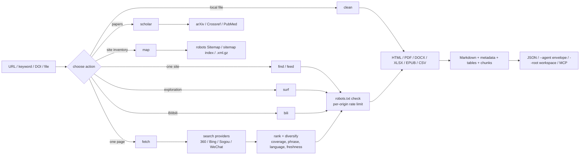

# web-forager

**Read the public web politely, and hand an agent one clean record it can trust.**

Search, fetch, extract and browse share one engine. Discovery uses 360, Bing, Sogou and Sogou WeChat; reading covers HTML, PDF, Office, EPUB, CSV, feeds and sitemaps; a real browser handles pages that need scripts or a login. The tool refuses targets it should not touch, and every record says what was skipped and why.

**English** · [简体中文](README_zh.md)

**Version:** 1.3.2 | **License:** MIT | **Python:** 3.10+ | **Node:** 18+ (browser mode)

> For learning and information gathering only. Read the [full legal notice](#full-legal-notice) before relying on any output.

---

## Contents

**Start**

- [Why web-forager](#why-web-forager)
- [Install and download](#install-and-download)
- [Quick start](#quick-start)
- [Things you can just ask](#things-you-can-just-ask)

**Going deeper**

- [Two modes, one record](#two-modes-one-record)
- [How a run flows](#how-a-run-flows)
- [What a run looks like](#what-a-run-looks-like)
- [Repository layout](#repository-layout)
- [Full reference](#full-reference)
- [Security boundary](#security-boundary)
- [Scope and compliance](#scope-and-compliance)

**Other**

- [Requirements](#requirements)
- [Tests](#tests)
- [Full legal notice](#full-legal-notice)
- [Known limitations](#known-limitations)
- [Issues and feedback](#issues-and-feedback)
- [Acknowledgements](#acknowledgements)
- [Trademarks](#trademarks)
- [License and author](#license-and-author)

---

## Why web-forager

Search APIs return links. Scrapers read pages but ignore the rules. An agent needs discovery, reading and a record it can verify, without an API key or a hosted index in between. This repository puts all three in one engine.

HTML, PDF, DOCX, XLSX, EPUB, CSV, RSS/Atom, sitemaps, Bilibili and rendered pages all return the same four fields: `metadata`, `markdown`, `tables` and `warnings`. A caller does not branch on the source.

The fetcher enforces robots.txt, a per-origin delay, response-size caps, redirect limits and a contactable User-Agent on every request, including each search, sitemap and surf hop. Those rules live in the code, not in a promise on this page.

Missing optional pieces do not crash a run. A missing bridge exits 3, missing Playwright 6, missing `pypdf` 7. A site without a sitemap returns an empty result with a note, and a verification page is reported as `verification_required` rather than passed off as content.

Every record explains what happened. `engine_report` lists each engine with its latency and error, `skipped` lists results that could not be read, `degraded` means the page was read but the playbook found nothing, and fetched text carries `trust: "untrusted"`. When text looks like a prompt, `injection_findings` adds the rule code, severity, character span and matching snippet.

Ranking uses coverage, title and phrase match, the engine's own rank, intent cues, a year match, a small domain prior and snippet freshness. Duplicate URLs are canonicalized (`utm_*`, fragments, `www.`, trailing slash), hits from several engines get an RRF contribution, and light stemming lets `injection` match `injections`. A result needs the exact phrase or at least two meaningful terms. A Chinese tutorial that merely repeats one English product name is marked `language_match: false` and dropped when enough real answers exist.

Quiz and answer-key pages and paid placements are demoted, reposts of one article are merged, and each host gets one slot before any host gets a second (at most two). When the engines return nothing primary that answers the question, a curated official page is added with `source: "official-entry"`: Python asyncio, Go, Rust, MDN, Wi-Fi, GDPR Article 17, the EU AI Act, Chinese policy, a DOI resolved through `doi.org`, or an entity site such as WHO, UN or NASA.

`search_quality` counts relevant, off-topic, language-mismatched and quiz rows. `risk` flags a list with no official, primary or academic source, a WeChat-heavy list, or an answer from one engine. `evidence` says whether any result states the specific claim in the question (`supported`, `uncertain` or `unsupported`) and adds a warning when none does.

When a server returns almost no HTML, `--render auto` renders the page once with Playwright before extraction. `fetch --query` and `surf` allow at most two rendered pages per run.

---

## Install and download

Install this repository as one plugin. The CLI, both MCP servers and `SKILL.md` share a single engine and a single robots/cache pipeline; splitting the tree breaks that.

Most people take method one, which lets an AI install it. A host with a plugin marketplace takes method two. A terminal install, or several hosts at once, takes method three.

## Method 1: let your AI install it

```bash
Visit the GitHub repository `https://github.com/JiamingShi-JsPhys/web-forager`, clone it, and run `python install.py --project . --global`. If your host has a plugin system, install the whole thing as a single plugin instead; that script covers the hosts that read rule files.
```

## Method 2: install from the plugin marketplace by URL

Each host below has its own plugin marketplace. Register this repository's Git URL, then install the plugin it lists. Registering the same URL twice is harmless; the second call reports that it is already known.

```text
https://github.com/JiamingShi-JsPhys/web-forager
```

Append `#v1.3.2` to pin the install to this release. Drop it to follow the default branch.

## Method 3: install with commands

Claude Code, Codex, dsh and CodeBuddy take a one-line plugin command. Cursor, Windsurf, Cline, Continue, Roo Code, GitHub Copilot and opencode read a rule file, and one script writes all of them. Every command, every flag and the optional dependencies are on one page: **[docs/INSTALL_COMMANDS.md](docs/INSTALL_COMMANDS.md)**.

Each plugin host gets its own MCP launch file. Claude Code reads `.mcp.json`, Codex reads `.codex-plugin/mcp.json`, CodeBuddy reads the `mcpServers` block in `.codebuddy-plugin/plugin.json`, and dsh reads the two `dsh-mcp-client` entries in `cordis.patch.yml`. After installing in CodeBuddy or dsh, start a new session so the servers mount. `codebuddy mcp list` can run before plugins load and is not a health check.

### Keeping an installed copy current

A host copies the plugin into a cache of its own, and that copy is what actually runs. A fixed bug keeps running until the cache is refreshed. A marketplace backed by a local folder may also hold a snapshot rather than the live directory.

For ZCode, refresh the marketplace index first, then the plugin:

```bash
zcode plugins marketplace update web-forager-marketplace
zcode plugins update web-forager@web-forager-marketplace
```

If the version number did not change between two installs, `update` may treat the cache as current. Reinstall it instead:

```bash
zcode plugins uninstall web-forager@web-forager-marketplace --force
zcode plugins install web-forager@web-forager-marketplace --yes
```

Claude Code users can run `claude plugin update web-forager`. If the marketplace index is stale, refresh it first with `claude plugin marketplace update web-forager-marketplace`. After any update, `python run.py --action doctor` reports what the running copy can actually see.

---

## Quick start

Three ways in, plus an optional browser mode. Pick the one that matches where you already are.

### From the chat box

The skill is registered under the `web-forager` namespace, so it is one `/` away:

```text
/web-forager:web-forager collect https://www.bilibili.com/video/BV1xx411c7mD as Markdown
```

Say what you need after the name. The skill picks the action and returns Markdown, metadata, tables and warnings. A page that robots.txt disallows is refused, not fetched.

Five commands cover the usual jobs:

| Command | Does |
|---|---|
| `/web-forager:fetch` | Fetch one URL, or search a keyword and read the results |
| `/web-forager:surf` | Search or open a seed URL, then follow ranked in-page links with a resumable session |
| `/web-forager:scholar` | Query arXiv, Crossref or PubMed, or resolve a DOI |
| `/web-forager:map` | Discover page URLs from robots.txt Sitemap lines, sitemap indexes and `.xml.gz` files |
| `/web-forager:browse` | Run a read-only browser playbook through the browser MCP server |

```text
/web-forager:fetch https://example.org/article
/web-forager:scholar 10.1038/nature14539
/web-forager:browse read this WeChat article: https://mp.weixin.qq.com/s/...
```

### From a terminal

Install the Python dependencies once:

```bash
pip install -r requirements.txt
```

Read one page as Markdown, metadata and tables:

```bash
python run.py --action fetch --url "https://example.org/article"
```

Search, then read the most relevant pages:

```bash
python run.py --action fetch --query "city walk guide" --num-results 8 --max-pages 3
```

Broad recall, then cited evidence only:

```bash
python run.py --action research --query "Python 3.12 asyncio.TaskGroup default exception handling" --focus 3
```

`research` ranks sources by relevance and an explicit authority tier. When the broad pool has no authoritative answer, it makes one narrow `site:` or arXiv-title query, reads a few distinct hosts, and returns the matching passages with their URLs plus an `answerability` verdict. It says `none` or `low` instead of inventing an answer.

A paper, without touching a result page:

```bash
python run.py --action scholar --source doi --query "10.1038/nature14539"
```

Search defaults to `auto`. A mostly-CJK query goes to 360, Sogou and Sogou WeChat; a Latin query goes to 360 and Bing. If the engines are blocked, the [full reference](docs/REFERENCE.md#when-the-engines-are-blocked) shows the site-search and feed routes that need no engine at all.

Not sure which action you need?

| You have | Use |
|---|---|
| one URL or a keyword | `--action fetch` |
| a question that needs cited evidence | `--action research` |
| a site you trust, no working search engine | `--action find --site <HOST> --query <TEXT>` |
| a blog or news site | `--action feed --url <SITE>` |
| a PDF, DOCX, XLSX, EPUB or CSV | `--action clean --input <FILE>` |
| a topic to explore link by link | `--action surf --query <TEXT>` |
| a DOI, arXiv id or paper title | `--action scholar` |
| a site whose pages you want to enumerate | `--action map --url <SITE>` |
| Bilibili | `--action bili` |
| "why is this not working" | `--action doctor [--probe]` |

Add `--agent` to any action for a machine-readable `{"ok":true,"data":...}` envelope. Add `--out result.json` to keep the full record on disk, or `--root <WS>` to publish it into a workspace (`<WS>/process/web-forager/` and `<WS>/_broadcast/`). See [records and output](docs/REFERENCE.md#records-and-output).

### From an MCP client

```json
{
  "mcpServers": {
    "web-forager": {
      "command": "python",
      "args": ["/absolute/path/to/web-forager/mcp_server.py"]
    },
    "web-forager-browser": {
      "command": "node",
      "args": ["/absolute/path/to/web-forager/browser/mcp_server.js"]
    }
  }
}
```

The HTTP server exposes ten tools (`web_fetch`, `web_search`, `web_research`, `web_surf`, `web_scholar`, `web_map`, `web_bilibili`, `web_doctor`, `web_find`, `web_feed`). The browser server exposes four (`browser_list`, `browser_run`, `browser_session`, `browser_doctor`).

MCP calls cannot relax the safety boundary: no tool parameter turns robots off, changes the injection gate, sets a proxy, supplies a browser bridge or allows a write action. The local file `clean` action is CLI-only and is not an MCP tool. One switch keeps a search cheap: `max_pages: 0` returns the result list with no page bodies, and `compact: true` trims each result to title, URL, domain, relevance and a short snippet (measured 4.9k to 2.2k characters on the same query). A repeated identical query inside five minutes is served from the on-disk list cache. `web_search` also returns `engine_report` and warnings when the results do not mention the query.

### Browser mode (optional)

Browser mode needs Node.js 18+ and a bridge command, and is read-only by default. Sign in once with `python browser/launch_chrome.py`. CDP is off by default; the launcher opens the dedicated profile. Then run the browser with the default backend, which reuses that profile. If you specifically need DevTools attach, start the launcher with `--cdp` and pass `--backend cdp`. The eight playbooks, their switches, `--strict-robots`, storage state and the cost controls are in the [full reference](docs/REFERENCE.md#browser-mode). Reach for `wechat-dig` when an HTTP search found a WeChat article but robots.txt and the environment check stopped the read.

---

## Things you can just ask

| Say it your way | Routes to | You get back |
|---|---|---|
| "Read this article and keep the tables" | `fetch --url` | Markdown, metadata, tables and any extraction warnings |
| "Find recent writing on X" | `fetch --query` | Ranked, de-duplicated results, optionally the top pages |
| "What does this site publish?" | `map --url` | Page URLs from robots.txt Sitemap lines and sitemap indexes |
| "Follow this topic from that page" | `surf --query` or `--url` | A resumable link-by-link walk, one state change per cycle |
| "Find papers on X" | `scholar --source arxiv` | arXiv metadata and abstracts, not a scraped result page |
| "What is this DOI?" | `scholar --source doi` | One normalised bibliographic record |
| "Read this PDF / Word file" | `clean --input` | The same Markdown record as an HTML page |
| "Why is this failing?" | `doctor --probe` | Dependency versions and which search engines answer here |
| "Read this WeChat article" | `browse` + `wechat-dig` | The article, or an honest `blocked` when the profile has not passed the check |
| "Open the page behind my login" | `browse` + `--backend cdp` | What the page shows to that profile, with the shared-profile warning |

---

## Two modes, one record

| | HTTP mode | Browser mode |
|---|---|---|
| Reads | what the server returns | what a person sees once scripts run and login state applies |
| Entry points | `run.py`, `mcp_server.py` | `browser/run.js`, `browser/mcp_server.js` |
| Needs | Python 3.10+ | Node.js 18+ and a bridge command |
| Covers | search, HTML/PDF/Office/feeds, sitemaps, surf, Bilibili, scholarly APIs | eight read-only playbooks, rendered pages, danmaku, WeChat articles |

Both modes agree on four core fields (`metadata`, `markdown`, `tables` and `warnings`) and extend them differently. `--core` on either CLI, or `core: true` on `browser_run`, folds a record onto one documented shape ([records and output](docs/REFERENCE.md#records-and-output)).

Only Bilibili has a site-specific HTTP adapter. Zhihu, Xiaohongshu, Weibo and Douban are read as ordinary pages in HTTP mode. Zhihu and Xiaohongshu add browser playbooks; Weibo and Douban have none. WeChat articles are the one case HTTP mode regularly cannot finish: robots.txt disallows the article path, and the page itself answers with an environment check. `wechat-dig` opens it in a browser profile instead, and reports `blocked` when that profile has not passed the check rather than solving it.

---

## How a run flows

Every request enters through the same `HttpFetcher`, which applies the robots policy, cache, retry/backoff, per-origin rate limiter and size cap. The chosen action routes the payload to the matching extractor, and all extractors converge on one Markdown record.



`surf` only follows `<a href>` links that already exist in the page. It never constructs guessed URLs, submits forms or executes page JavaScript. `map` reads only published sitemaps, and `scholar` calls documented APIs instead of scraping result pages.

Browser mode is a second loop beside this one. The bridge supplies a page, `browser/run.js` reads a DOM snapshot, the session decides what is new, the playbook picks the next navigation step and a capture is written. Only one state-changing action runs per observation cycle, and write-like controls are denied by default.

---

## What a run looks like

A search that can read every result:

```text
$ python run.py --action fetch --query "city walk guide" --num-results 8 --max-pages 3
mode: search
pages: 3/3 readable
skipped: none
engine_report: 360 (0), Sogou (7, 0.7 s), WeChat (8, 0.5 s)
```

A search where one source refuses:

```text
skipped: 5
  robots_denied  https://mp.weixin.qq.com/s?...
  robots_denied  https://mp.weixin.qq.com/s?...
warnings:
  robots.txt denied the skipped paths. Use --robots-policy warn only when you are authorised to read them; the record will mark the override.
  WeChat article links cannot be read in HTTP mode ... open one with browser mode: browser_run with playbook "wechat-dig".
```

The second run also succeeded. It reported what it could not read instead of returning an error page as the article.

---

## Repository layout

```text
web-forager/
├── run.py                 # one CLI entry: fetch, research, find, feed, clean, surf, scholar, map, bili, doctor
├── mcp_server.py          # stdio JSON-RPC, ten HTTP tools
├── scripts/               # engine, extractors, search parsers, robots, cache, untrusted screen
├── browser/               # Node browser mode: run.js, MCP server, playbooks, bridge, profile launcher
├── commands/              # slash commands: fetch, surf, scholar, map, browse
├── docs/                  # reference, install commands, dependencies, acknowledgements
├── tests/                 # Python suite and offline fixtures
└── browser/tests/         # browser suite: fake backend, fake bridges, recorded snapshots
```

Per-directory detail, every action and flag, record shapes and the full exit-code table are in **[docs/REFERENCE.md](docs/REFERENCE.md)**.

---

## Full reference

Records, the full action list, exit codes, requirements, repository layout and test details live in **[docs/REFERENCE.md](docs/REFERENCE.md)**, so this page stays a quick start.

| Exit code | Means |
|---|---|
| `0` | the action finished; unreadable results are listed in `skipped` |
| `2` | argument or URL error |
| `3` | robots.txt denied the request, or no browser bridge configured |
| `4` | network, HTTP or navigation failure |
| `5` | extraction or capture failed |
| `6` | Playwright requested but unavailable, or a login wall in browser mode |
| `7` | PDF requested but `pypdf` unavailable |
| `8` | `degraded`: the page was read but the playbook found nothing |
| `9` | `blocked` or `verification_required`: an anti-bot or verification page replaced the content |
| `10` | the query was refused because it asked to profile a private person |
| `130` | interrupted |

`--agent` keeps these codes and writes `{"ok":false,"error":{"code","message","hint"}}` on stdout.

---

## Security boundary

The tool makes the requests a prompt or an agent asks for, so the boundaries are in the code rather than left to the caller's memory.

Private targets are refused. Loopback, RFC 1918, link-local (including `169.254.169.254`), CGNAT and their IPv6 forms are rejected before a socket opens, and again on every redirect hop, so a public URL cannot bounce the client into the LAN. `--allow-private` exists for local fixtures and trusted intranet tools and is off by default. Both MCP servers clear it, so a model cannot inherit the switch from the operator's shell. The browser side installs the same guard as a request filter, so a hostile page cannot probe `http://127.0.0.1:...`.

robots.txt is a policy, not a lock. The default `--robots-policy respect` refuses a disallowed path. `warn` reads it and writes `compliance.robots_overridden: true`; `ignore` records that robots was not consulted. A denial is reported to the caller, and it is not a cue to retry the same URL with a tool that ignores robots.

Query endpoints have their own policy. Search engines and scholarly APIs are not target pages, so they use `--query-robots` (or `WEB_FORAGER_QUERY_ROBOTS`), default `warn`. Bing, 360, Sogou and the arXiv export API disallow their query paths, so the default reads them and records `query_robots: warn` in the engine report; `respect` refuses and `ignore` skips the check. Only a user can choose, and MCP never accepts the switch from the model. For target pages, the operator who starts the MCP server may set `WEB_FORAGER_ROBOTS_POLICY=warn` (or `ignore`); the default remains `respect`, and every override is recorded in `compliance.robots_overridden`.

The browser keeps its own profile. The bundled bridge stores state under `~/.web-forager/browser/profile`, not in the browser you use every day. `browser/launch_chrome.py` starts Chrome on that profile, and `--save-storage-state` writes a Playwright state file with mode `0600` (refused inside `--root`). Attaching over CDP to a personal browser still works, but the run is marked `shared_browser: true` with a warning: every cookie and login in that profile is reachable by the pages a playbook opens.

Fetched text is data, and says so. Every record carries `trust: "untrusted"`. When a page contains instruction-shaped text, `injection_findings` records the code, severity, character span and a short matching snippet, and the first warning repeats up to three of those snippets. Hard rules (forged system tags, secret-exfiltration requests, `curl ... | sh`, `rm -rf /`) can make `--input-gate strict` withhold the body. Soft rules ("ignore previous instructions", role swaps) are reported but never withhold on their own, because papers and security notes quote them legitimately. The scan covers the whole body in overlapping windows, before `max_chars` truncation. This is a screen, not a sandbox: the host must still keep untrusted content, private data and outbound requests out of one autonomous loop.

### Privacy and local state

No telemetry, no account, no API key. The plugin does not send usage data anywhere. It makes the requests you ask for to the selected search engine, scholarly API or site; your query and the target URL necessarily leave the machine for that request.

On-disk state is local. With caching on, page bodies and response metadata live under `~/.web-forager/cache` for one hour. Responses that set cookies are not cached, and `Authorization` / `Proxy-Authorization` headers are stripped. On POSIX the cache directory is `0700` and its files `0600`.

Sessions and browser state are local too. Surf sessions (`~/.web-forager/sessions`) contain visited URLs; browser sessions live under `~/.web-forager/browser/sessions`; `--save-storage-state` writes cookies with mode `0600`; the dedicated browser profile is `0700`. `--verbose` logs the scheme, host and path only. The query string and fragment are dropped, so a signed URL does not put its token on stderr.

The DevTools port is off by default. `browser/launch_chrome.py` opens only the dedicated profile unless you pass `--cdp`; then it binds Chrome's CDP port to loopback and picks a random free port (`--port 9222` makes it fixed). Any local process can still attach while it is open, so keep it on loopback and close the browser when you are finished.

Personal data is not a target. The doxxing guard refuses explicit person-profiling queries and warns on a bare name. It is intent-based, not a guarantee. Do not use the tool to collect or assemble private information about an identifiable person.

---

## Scope and compliance

The core engine is an original clean-room implementation. No source is copied from Crawlee, Scrapy, Colly, Katana or any other crawling framework, and no GPL/AGPL dependency is used. The tool never bypasses a login, CAPTCHA, Cloudflare challenge or paywall, and it does not run concurrent request floods. `robots.txt` (RFC 9309 subset) is checked before every target page according to `--robots-policy`. Each request carries a contactable information-gathering User-Agent, and the default rate is one request per second per origin, including search, sitemap and surf hops.

Where a site answers with a verification page, the record says `verification_required` and stops. Where a browser profile has not passed a site's check, the playbook says `blocked` and stops. Neither path tries to satisfy the challenge.

---

## Requirements

Python 3.10+ and the packages in `requirements.txt` (`requests`, `beautifulsoup4`, `trafilatura`). Optional: `playwright` for JavaScript rendering, `pypdf` for PDF text. Browser mode additionally needs Node.js 18+ and a bridge command; the bundled bridge needs `playwright` installed with npm and its Chromium binary.

```bash
pip install playwright && playwright install chromium
```

A missing optional package never crashes a run: Playwright is exit code 6, `pypdf` is exit code 7, and the record carries an install hint. The per-capability matrix is in [DEPENDENCIES.md](DEPENDENCIES.md).

## Tests

```bash
python -m pytest
node --test "browser/tests/*.test.js"
```

385 Python tests and 92 browser tests, all offline. The Python suite starts a temporary local HTTP server for robots.txt, articles, PDF/Office files, feeds, sitemaps, search-result pages and multi-hop surf pages. The browser suite uses a fake backend and fake bridges that speak the same wire protocol, plus snapshots recorded from live pages. CI runs both from a repository clone; release archives exclude the test folders.

## Full legal notice

### What this tool is for

web-forager automates reading publicly reachable pages, for learning, research, monitoring and personal knowledge work only.

### What it must not be used for

- Identifying, locating, profiling or contacting a private individual, or assembling scattered records into a picture of a person.
- Harassment, stalking, intimidation, doxxing, or any invasion of another person's privacy.
- Bypassing logins, CAPTCHAs, paywalls or access controls, or placing load on a site beyond the built-in rate limit.
- Sending malicious concurrent requests, or any denial-of-service-style access, to a target site.
- Any use that breaks the law where you are, or the terms of the site you are reading.

### Your responsibility

It is the end user's responsibility to obey all applicable local, state and federal laws and the Terms of Service and copyright of every site reached. The authors do not grant permission to access anything you are not entitled to read, and do not verify that a given use is lawful. The user bears full legal responsibility for how this software is used.

### No warranty

The software is provided "as is", without warranty of any kind, express or implied, as stated in the [MIT License](LICENSE). It may fail, return incomplete or outdated content, or change behaviour between versions.

### Limitation of liability

To the maximum extent permitted by law, the authors and contributors assume no liability and are not responsible for any misuse of this software or for any damage, loss or legal consequence arising from it. Fetched text comes from third-party sites and is not endorsed or checked by this project.

### If you redistribute it

Keep this disclaimer and the licence notice with any copy you publish or fork.

---

## Known limitations

### Read before use

This is a low-frequency tool, not a crawler fleet. Each origin gets one request at a time, at least a second apart by default; jitter only adds time, and a `429` lengthens that origin's back-off. A `fetch --query` batch reads results from different origins concurrently, never two to the same origin. `surf`, search and sitemap reads stay serial. It is unsuitable for large-scale harvesting.

PDF extraction reads the text layer only. Scanned PDFs need OCR, which this plugin does not do.

Login walls are not bypassed. `zhihu-dig` and `xhs-dig` stop with `login_required`; reuse a logged-in profile through your bridge.

WeChat articles are not read in HTTP mode. robots.txt disallows `/s`, and with an override the URL returns an environment check. The record says `verification_required`; `wechat-dig` can read the article only in a profile that has already passed that check.

Default search records a robots override. Bing, 360, Sogou and the arXiv export API disallow their query paths. `--query-robots` defaults to `warn`, so search works but the engine report names the override. Set `respect` to refuse a disallowed endpoint, or `ignore` to skip the check.

An unreachable robots.txt means deny. That is the conservative RFC behaviour. `--ignore-robots` is only for resources you are explicitly authorised to access. MCP browser runs always pass `--strict-robots`; CLI browser runs consult robots.txt under `--strict-robots`, and every HTTP and browser redirect hop is re-checked. The record always states whether the check was made (`compliance.robots_checked`).

### Edge cases

Scholarly APIs return metadata and abstracts, not full papers. Respect each platform's terms.

`--render auto` is a heuristic with one bounded fallback. Short visible text plus SPA markers triggers rendering; a minimal script shell triggers one extra render. Complex sites may still need `--render always`, and `--wait-for` / `--scroll` only work when Playwright is installed.

Search depends on public result pages. Availability varies by network, and every parser (`parse_360_html`, `parse_bing_html`, `parse_sogou_html`, `parse_weixin_html`, `parse_ddg_html`) encodes an assumption about the result-page markup. Each has an offline fixture, so a redesign breaks the fixture test rather than silently returning nothing. A live page that is large but yields no results is reported as `parser_drift` in `engine_report` instead of "empty". Baidu is not supported: every public result endpoint answers with Baidu's security-verification page, so no parser is shipped (`doctor` states this). Sogou may show a human-verification page, and `--engine all` can fail partially. A Chinese query stays on the Chinese engines unless it also names a Latin token (API, version, product) and they came back thin, in which case one Bing fallback is added; dictionary pages are always dropped.

Only Bilibili has a site-specific HTTP adapter. The other sites named above are read as ordinary pages, which is enough for public article pages and not enough for logged-in feeds.

Browser mode needs a working bridge. `playwright` and its Chromium binary are installed separately, `--doctor` names whichever is missing, and with no bridge at all a live run exits 3.

`surf` follows ordinary links only. It does not click buttons, execute JavaScript or handle login walls.

DNS is resolved twice. The guard checks the addresses DNS returns, and the HTTP client then resolves again to connect. A hostile resolver that answers differently between the two calls (rebinding) is outside what this check can stop; pair it with an egress policy if that is your threat model.

### Experimental features and high-risk switches

Danmaku is experimental. Bridge `observe("danmaku", ms)` is preferred; DOM text is a fallback that assumes one visible `mm:ss text` layout, and the record says so in its warnings. Canvas-rendered text still needs OCR.

Browser selectors are heuristics. Every pattern about a third-party page lives in `browser/lib/selectors.js` and is regression-tested against snapshots derived from live pages (`browser/tests/fixtures/snapshots/`, recorded 2026-11-07). That catches drift after the fact, not before it. `npm run test:live` re-checks the live sites when you set `WEB_FORAGER_LIVE=1` and a bridge.

The injection screen is a screen, not a sandbox. It matches known phrasings and will miss paraphrases. `trust: "untrusted"` and the host's own permission model are what contain a hostile page; the flag list only makes the boundary visible.

The private-address guard has an off switch. `--allow-private` (or `WEB_FORAGER_ALLOW_PRIVATE=1`) exists for local fixtures and trusted intranet targets and disables the loopback/LAN/metadata check. Never set it for input you do not control.

CDP attach exposes the profile you attach to. The bundled bridge uses a dedicated profile, but `WEB_FORAGER_BROWSER_CDP` reuses a browser you already run, with every cookie and login in it.

---

## Issues and feedback

Ordinary bugs and feature requests go to the repository's [Issues](https://github.com/JiamingShi-JsPhys/web-forager/issues) page, with reproduction steps, expected behaviour, actual behaviour and your environment (operating system, Python version).

Security vulnerabilities (this category only): do not use the public issue tracker. Email `jiamingshi_git@outlook.com` instead.

- Subject: must carry the prefix `report_web-forager:` plus a short summary.
  - Example: `report_web-forager: path traversal can read outside the target folder`
- Body: must include detailed reproduction steps and the environment.

Contributors who file clear, reproducible issues or pull requests are credited in the next release's notes and in [Acknowledgements](#acknowledgements).

## Acknowledgements

NotFatJustRound: early testing and feedback.

DeepSec: the code-security auditor this repository is scanned with. It found the two command-injection paths closed in 1.2.3 and the supply-chain issue in the same release.

[Full acknowledgements](docs/ACKNOWLEDGEMENTS.md)

## Trademarks

"Bilibili", "Zhihu", "Xiaohongshu", "arXiv", "Crossref", "PubMed", "Claude", "Codex", "CodeBuddy", "ZCode" and "DeepSeek" are trademarks or registered trademarks of their respective owners. web-forager is an independent, third-party tool with no affiliation, endorsement or sponsorship from any of them. All requests go to public pages or documented APIs; users are responsible for complying with each platform's terms.

---

## License and author

MIT. See [LICENSE](LICENSE) and [THIRD_PARTY_LICENSES.txt](THIRD_PARTY_LICENSES.txt).

**Author and maintainer**: Jiaming Shi
