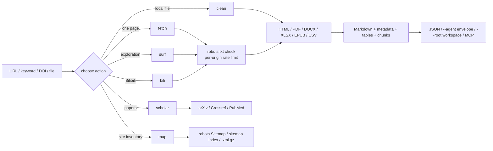

# web-forager

> **A clean-room, robots-aware web information gathering toolkit for agents and analysts, with a CLI, two MCP servers and a Claude Code skill.**
>
> It has two modes. **HTTP mode** searches 360 / Bing / Sogou / Sogou WeChat, reads HTML, PDF, DOCX, XLSX, EPUB, CSV and RSS/Atom, collects public pages from Bilibili through a dedicated adapter and from news sites, blogs and forums through the generic HTML pipeline, discovers sitemaps, splits long pages into context-sized chunks, caches responses politely, and can surf the open web link by link with resumable sessions. Optional scholarly lookups cover arXiv, Crossref, PubMed and DOI. **Browser mode** drives a real browser through a pluggable bridge for login-state pages, rendered content and Bilibili danmaku, following seven read-only playbooks that cover Bilibili, Zhihu and Xiaohongshu. Every HTTP page is checked against robots.txt and rate-limited per origin; browser mode reports whether robots.txt was consulted.

> ## Disclaimer (read this first)
>
> **This plugin is for learning and information gathering only. Users must comply with the Terms of Service of target websites and applicable copyright law. Malicious concurrent attacks are prohibited. Collecting, aggregating or inferring the personal information of an identifiable individual — or using it for doxxing, harassment, stalking or any other invasion of privacy — is prohibited; the user bears full legal responsibility for such use.**

**English** · [简体中文](README_zh.md)

**Version:** 1.2.0 | **CLI actions:** 9 | **MCP tools:** 10 | **Browser playbooks:** 7

---

## Security & Open Source Statement

> **Disclaimer**: This plugin is an auxiliary information-gathering tool developed to automate public web retrieval. It is not a peer-reviewed research project. The core engine is an original clean-room implementation: no source code is copied from Crawlee, Scrapy, Colly, Katana or any other crawling framework.
>
> The tool **never bypasses a login, CAPTCHA, Cloudflare challenge or paywall**. It does not target personal data and does not run concurrent request floods; building a profile of an identifiable person with it is forbidden by the disclaimer above. `robots.txt` is checked before every target page, every request carries a contactable information-gathering User-Agent, and the default rate is one request per second per origin.
>
> Fetched text comes from third-party sites; this plugin is not responsible for that content or for any consequence of using it.

---

## Why web-forager?

In the current agent ecosystem, tools solve one half of the problem: a search API returns links with no reading pipeline, or a scraper reads pages with no compliance layer. Neither supplies a stable contract between retrieval and the agent that consumes it. web-forager supplies both, in one engine. Typical uses include monitoring topics on Bilibili, Zhihu and Xiaohongshu, collecting articles and public discussions, and building a personal knowledge base.

**One engine serves every source.** HTML, PDF, Office documents, ebooks, feeds, sitemaps, Bilibili and ordinary web pages all return the same four core fields: `metadata`, `markdown`, `tables` and `warnings`. A caller does not need a different code path per content type. Only Bilibili has a site-specific HTTP adapter; Zhihu and Xiaohongshu are covered by browser playbooks, and Weibo, Douban and other sites are read as ordinary pages with no site-specific code. `--core` folds both modes onto one documented record so a mixed result list stays uniform.

**Compliance is built into the fetcher, not bolted on.** robots.txt (RFC 9309 subset), per-origin rate limiting, response-size caps, redirect limits and an explicit information-gathering User-Agent apply to every request, including search, sitemap and surf hops.

**Agent-first interfaces degrade instead of crashing.** `--agent` yields a stable `{"ok":…}` envelope, `mcp_server.py` exposes ten MCP tools, `browser/mcp_server.js` exposes four more, and `--chunk-size` splits long pages by heading. Missing Playwright returns exit code 6, missing `pypdf` returns exit code 7, and a site without a sitemap returns an empty result with a note.

**Two modes cover both halves of the web.** HTTP mode reads what the server returns: fast, auditable, robots-aware. Browser mode reads what a person actually sees after scripts run, login state applies and a player is mounted. It ships no browser of its own: it starts a bridge command and speaks a small JSON-RPC protocol to it. The bridge bundled under `browser/bridges/` is used automatically; `--bridge` or `WEB_FORAGER_BRIDGE` overrides it. When no bridge can be found, a live run exits 3 instead of pretending a page was read. Both modes share four core record fields and extend them differently; `--core` on either mode returns the shared shape (see [Records](#records)).

---

## How a run flows

Every request enters through the same `HttpFetcher`: robots policy, cache, retry/backoff, per-origin rate limiter and size cap. The chosen action then routes the payload to the matching extractor, and all extractors converge on the same Markdown plus metadata record.



`surf` only follows `<a href>` links that already exist in the page; it never constructs guessed URLs, submits forms or executes page JavaScript. `map` reads only published sitemaps, and the optional scholarly action calls documented APIs instead of scraping result pages.

Browser mode is a second loop beside this one: the bridge supplies a page, `browser/run.js` reads a DOM snapshot, the session decides what is new, the playbook picks the next navigation step and a capture is written. Only one state-changing action runs per observation cycle, and write-like controls are denied by default.

---

## Installation

Install it as one plugin: the CLI, both MCP servers and `SKILL.md` share a single engine, so splitting the tree breaks it.

### Method 1: install from the plugin marketplace by URL

Every host below has its own plugin marketplace. Register this repository's Git URL, then install the plugin it lists (registering the URL twice is harmless — the second call reports it is already known).

```bash
https://github.com/JiamingShi-JsPhys/web-forager
```

### Method 2: install with commands

Claude Code, Codex, dsh and CodeBuddy take a one-line plugin command; Cursor, Windsurf, Cline, Continue, Roo Code, GitHub Copilot and opencode read a rule file, and one script writes all of them. Every command, every flag and the optional dependencies live on one page: **[docs/INSTALL_COMMANDS.md](docs/INSTALL_COMMANDS.md)**.

### Method 3: let your AI install it

```bash
Please visit the GitHub repository `https://github.com/JiamingShi-JsPhys/web-forager` and clone it, then run `python install.py --project . --global`. If your host has a plugin system, install it as a single plugin instead; the script covers the hosts that read rule files.
```

> **Warning**: when an AI performs the installation it will very likely scatter `scripts/`, `run.py` and `SKILL.md` into unrelated folders. The modules import each other and the MCP server assumes the plugin-relative layout, so a scattered copy stops working. Use Method 1 if you need the full plugin.

---

## Quick start

Install the plugin, then stay in the chat box: type `/` and pick a skill or a command. No shell, no absolute path — the folder you are working in is the workspace.

### Skills

The skill is registered under the `web-forager` namespace, so it is one `/` away:

```text
/web-forager:web-forager  collect https://www.bilibili.com/video/BV1xx411c7mD as Markdown
```

Say what you want after the name; the skill picks the action and returns Markdown, metadata, tables and warnings. A page that robots.txt disallows is refused, not fetched.

### Commands

Four commands put the common actions behind a single line:

| Command | Does |
|---|---|
| `/web-forager:fetch` | Fetches one URL, or searches a keyword and reads the results |
| `/web-forager:surf` | Searches or opens a seed URL, then follows ranked in-page links with a resumable session |
| `/web-forager:scholar` | Queries arXiv, Crossref or PubMed, or resolves a DOI |
| `/web-forager:map` | Discovers page URLs from robots.txt Sitemap lines, sitemap indexes and `.xml.gz` files |

```text
/web-forager:fetch https://example.org/article
/web-forager:scholar 10.1038/nature14539
```

Search defaults to `auto`. A mostly-CJK query is sent to 360, Sogou and
Sogou WeChat; `--engine weixin` asks the WeChat article index directly, which is
the one channel that normally carries a Chinese person's or institution's name.

### Browser mode

The browser layer lives in `browser/` and needs Node.js 18 or newer. It is
read-only by default: like, coin, favourite, follow, share, comment, danmaku and
publish are denied unless `--allow-write` is passed after the user authorises
that single action.

```bash
node browser/run.js --list
node browser/run.js --doctor
node browser/run.js --playbook bili-feed --session bili-01 --max-items 8 --agent
node browser/run.js --playbook bili-video --url "https://www.bilibili.com/video/BV1xx411c7mD"
node browser/run.js --playbook bili-chain --url "https://www.bilibili.com/video/BV1xx411c7mD"
node browser/run.js --playbook bili-danmaku --url "https://www.bilibili.com/video/BV1xx411c7mD"
node browser/run.js --playbook zhihu-dig --query "reinforcement learning" --agent
node browser/run.js --playbook xhs-dig --query "city walk guide" --agent
node browser/run.js --playbook search-dig --query "reinforcement learning" --agent
node browser/run.js --playbook bili-feed --dry-run
```

The bundled bridge is picked up automatically once `playwright` and its
Chromium binary are installed; `--bridge` or `WEB_FORAGER_BRIDGE` points at a
bridge elsewhere:

```bash
npm install playwright && npx playwright install chromium
node browser/run.js --playbook bili-feed --doctor   # says what is still missing
```

`WEB_FORAGER_BROWSER_HEADFUL=1` shows the window,
`WEB_FORAGER_BROWSER_PROFILE=/path` reuses a persistent profile (this is what
carries login state for the `extension` backend), and
`WEB_FORAGER_BROWSER_CDP=http://127.0.0.1:9222` attaches to a browser you
already control (`cdp`). Backend labels are bookkeeping: the bridge declares its
real capabilities through an optional `describe` call, and the run payload
records exactly what it declared. A bridge that does not implement `describe`
is reported as `declared: false` with every capability false, so no playbook
assumes a call the bridge cannot serve.

`--strict-robots` fetches `robots.txt` before every navigation and stops with
`robots_denied` (exit 3) on a disallowed path. Without it the record still says
so: `compliance.robots_checked` is `false` and the note explains that the check
was not made. A run that reaches the site but finds nothing readable — an empty
feed, no result cards, a blank page — is reported as `degraded` (exit 8) with
its records attached, instead of an `ok: true` envelope with `captured: 0`. An
anti-bot or error interstitial stops the run with `blocked` (exit 9). Both are
separate from `login_required` (exit 6), which means the site asked for
credentials.

| Playbook | Does | Requires |
|---|---|---|
| `bili-feed` | Home feed, scroll and capture unseen cards | none |
| `bili-video` | One video and its visible comments | `--url` or `--bvid` |
| `bili-chain` | Follow the next-episode control and resume from the session | `--url`, `--bvid`, or a chain |
| `bili-danmaku` | Timestamped danmaku, preferring bridge `observe` over DOM text (experimental) | `--url` or `--bvid` |
| `zhihu-dig` | Zhihu search, rank links, capture the best unseen page | `--query` |
| `xhs-dig` | Xiaohongshu public notes, rank `/explore` links, capture one | `--query` |
| `search-dig` | Bilibili search, rank cards, open the best unseen result | `--query` |

`zhihu-dig` and `xhs-dig` return `login_required` (exit 6) when the platform
shows a login wall; they never try to get around it.

#### Running it cheaply

A browser run is the most expensive thing the plugin does, so its defaults are
small and its cost knobs are worth knowing:

- **Keep records on disk.** `--out result.json` (CLI) or
  `out: "C:/path/result.json"` (MCP) writes the full record and returns a short
  summary, so a ten-screen feed walk does not land in the agent's context.
- **No screenshots by default.** Playbooks capture text, not pixels; one
  screenshot costs roughly as much context as a page of prose. Ask for one only
  when the layout itself is the question.
- **Stay polite.** `--max-screens 5` and `--min-interval 3000` are the limits
  worth keeping (the defaults are 3 screens and 1000 ms). A long walk is better
  split into several runs that resume from `--session`.
- **Danmaku is experimental.** `bili-danmaku` prefers the bridge's `observe`
  call and falls back to DOM text with a `partial` warning; verify a small
  sample before relying on it.
- **Login state comes from a browser you already run.** Start Chrome with
  `--remote-debugging-port=9222`, set `WEB_FORAGER_BROWSER_CDP` to that address
  and pass `--backend cdp`; a persistent profile
  (`WEB_FORAGER_BROWSER_PROFILE`) does the same across runs. The `extension`
  backend is a slot for an extension bridge, which this repository does not
  ship.

### MCP servers

```json
{
  "mcpServers": {
    "web-forager": {
      "command": "python",
      "args": ["/absolute/path/to/web-forager/mcp_server.py"]
    },
    "web-forager-browser": {
      "command": "node",
      "args": ["/absolute/path/to/web-forager/browser/mcp_server.js"]
    }
  }
}
```

HTTP tools: `web_fetch`, `web_search`, `web_surf`, `web_scholar`, `web_map`,
`web_bilibili`, `web_clean`, `web_doctor`, `web_find`, `web_feed`. Browser tools:
`browser_list`, `browser_run`, `browser_session`, `browser_doctor`. Test the protocol
directly:
Two switches keep a search cheap: `max_pages: 0` returns the result list with no
page bodies (fetch one with `web_fetch` and a small `max_chars`), and
`respect_robots: false` reads a page robots.txt disallows, only for resources you
are authorised to read. A search whose results do not mention the query comes
back with a `warnings` entry saying so.


```bash
printf '%s\n' '{"jsonrpc":"2.0","id":1,"method":"initialize","params":{}}' \
  '{"jsonrpc":"2.0","id":2,"method":"tools/list"}' | python mcp_server.py
```

```bash
printf '%s\n' '{"jsonrpc":"2.0","id":1,"method":"initialize","params":{}}' \
  '{"jsonrpc":"2.0","id":2,"method":"tools/list"}' | node browser/mcp_server.js
```

### Workspace output

```bash
python run.py --action fetch --url "https://example.org/article" --root <WS>
```

Writes only:

```text
<WS>/process/web-forager/web-forager_<timestamp>_<slug>.json
<WS>/process/web-forager/web-forager_<timestamp>_<slug>.md
<WS>/_broadcast/web-forager_<timestamp>_<slug>.json
```

`material/` and `results/` belong to the user and the orchestrator; web-forager never writes there.

Browser captures follow the same discipline:

```text
<WS>/process/web-forager/browser/web-forager-browser_<timestamp>_<slug>.json
<WS>/process/web-forager/browser/web-forager-browser_<timestamp>_<slug>.md
<WS>/_broadcast/web-forager-browser_<timestamp>_<slug>.json
```

### Records

The two modes agree on the retrieval core and differ everywhere else. This is
the actual comparison, not a claim that the records are identical:

| Field | HTTP mode | Browser mode |
|---|---|---|
| `metadata`, `markdown`, `tables`, `warnings` | yes | yes |
| `url`, `title` | yes (`url` and `final_url`) | yes |
| `status`, `content_type`, `document_kind`, `cached`, `rendered`, `fetched_at`, `chunks`, `links` | yes | no |
| `schema_version`, `captured_at`, `playbook`, `backend`, `compliance`, `viewport_evidence`, `interaction_trace` | no | yes |

`--core` on either CLI, or `core: true` on `browser_run`, returns the shared
shape instead. Every record then has exactly these keys:

```json
{
  "schema_version": "core-1",
  "source": "web-forager",
  "mode": "http",
  "url": "https://example.org/article",
  "title": "An article",
  "collected_at": "2026-11-07T10:00:00Z",
  "metadata": {},
  "markdown": "...",
  "tables": [],
  "warnings": [],
  "extra": { "status": 200, "cached": false }
}
```

`mode` is `http` or `browser`, `source` names the producer, and `extra` keeps
every field the two modes do not share so nothing is lost. The same fold is
available as a library call: `engine.normalize_record()` in Python and
`normalizeRecord()` in `browser/lib/record.js`.

### When you need the CLI

The same operations run headlessly for scripts and CI:

```bash
python run.py --action fetch --url "https://www.bilibili.com/video/BV1xx411c7mD"
python run.py --action fetch --url "https://www.zhihu.com/" --render auto
python run.py --action fetch --url "https://www.xiaohongshu.com/explore" --render auto
python run.py --action fetch --query "city walk guide" --num-results 8 --max-pages 3
python run.py --action surf --url "https://www.zhihu.com/" --depth 1 --max-pages 5 --session zhihu-01
python run.py --action clean --input notes.pdf --format markdown
python run.py --action map --url "https://example.org" --limit 500
python run.py --action bili --mode feed --max-items 10
```

---

### Response shape

`results` is the list an agent loops over, and it is an index, not a second copy
of every page. For a search it carries `url`, `title`, `snippet`, `status`,
`content_type`, `markdown_chars`, `tables` and any `warnings` or `error`; the
Markdown body lives once, in `pages`, and a single `fetch` keeps it at the top
level. Pass `--full-results` (CLI) or `fullResults: true` (MCP) to get the old
shape, where `results` repeats the full records.

`--action doctor` reports every dependency with its version or the command that
installs it, so an agent that received a thin page can fix the cause itself.


### When HTTP mode is the right tool

A general search CLI already covers `web_search` and `web_fetch`. What it does
not cover is `web_scholar` (arXiv / Crossref / PubMed / DOI records) and
`web_map` (page discovery from robots.txt and sitemaps); those two are the
reason to reach for web-forager when a search tool would do.

### When the engines are blocked

Some networks answer a search with dictionary pages, a verification wall or a
timeout. Two routes do not depend on an engine:

```bash
python run.py --action find --site the-decoder.com --query "OpenAI watermark" --max-pages 3
python run.py --action feed --url https://the-decoder.com/ --num-results 10
```

`find` tries the site's own search URLs (`/?s=`, `/search?q=` and two more),
ranks the links by the query and fetches the best ones. `feed` discovers the
site's RSS/Atom `<link rel=alternate>` and reads it. `doctor --probe` asks every
engine once and reports which ones answer from this network, so a dead engine
becomes a fact instead of a mystery.

Requests honour `HTTPS_PROXY` / `ALL_PROXY`; `--proxy URL` overrides them for one
run. `doctor` reports the proxy in use with its credentials removed.

## Actions and exit codes

| Action | Purpose |
|---|---|
| `fetch` | one URL or keyword query → pages |
| `find` | search inside one site through the site's own search page |
| `feed` | read a site's RSS/Atom feed, discovering it from the page |
| `clean` | local or remote HTML/PDF/DOCX/XLSX/EPUB/CSV → Markdown |
| `bili` | Bilibili feed / video / related / search / surf |
| `surf` | search or seed URL, then ranked link BFS |
| `scholar` | arXiv / Crossref / PubMed / DOI records |
| `map` | page URLs from robots.txt and sitemaps |
| `doctor` | dependency report: what is installed, what to install |

| Exit code | Meaning |
|---|---|
| 0 | success |
| 2 | argument or URL error |
| 3 | robots.txt denied the request |
| 4 | network / HTTP failure |
| 5 | extraction failed |
| 6 | Playwright requested but unavailable |
| 7 | PDF requested but `pypdf` unavailable |
| 130 | interrupted |

Browser mode reuses those codes where the meaning carries over and adds two of
its own:

| Exit code | Browser meaning |
|---|---|
| 2 | argument error, or an unknown backend |
| 3 | `robots_denied` under `--strict-robots`, or no bridge configured |
| 4 | navigation failed |
| 5 | capture failed |
| 6 | `login_required`: the site asked for credentials |
| 7 | `confirmation_required`: a write-like action was denied |
| 8 | `degraded`: the page was read, but the playbook found nothing it looks for |
| 9 | `blocked`: an anti-bot or error interstitial replaced the page |
| 130 | interrupted |

`--agent` keeps these exit codes and prints a `{"ok":false,"error":{"code","message","hint"}}` envelope on stdout.

---

## Requirements

Python 3.10+. Core runtime: `requests`, `beautifulsoup4`, `trafilatura`. Optional: `playwright` (JS rendering), `pypdf` (PDF). `defusedxml` is used when already installed but is never required — XML with an internal DTD subset or any ENTITY declaration is rejected regardless. Browser mode additionally needs Node.js 18+ and a bridge command; `browser/bridges/playwright-bridge.js` needs `playwright` installed with npm. No third-party code is vendored; every library stays under its own permissive licence. No GPL/AGPL dependency is used. The full per-capability matrix lives in [docs/DEPENDENCIES.md](docs/DEPENDENCIES.md).

---

## Repository layout

```text
web-forager/
├── .claude-plugin/               Claude Code manifest + marketplace
├── .codex-plugin/                Codex manifest + marketplace
├── .codebuddy-plugin/            CodeBuddy manifest + marketplace
├── .dsh-plugin/                  DSH manifest + CJS entry
├── .cursor/rules/                Cursor rule file
├── .windsurf/rules/              Windsurf rule file
├── .clinerules/                  Cline rule file
├── .continue/rules/              Continue rule file
├── .roo/rules/                   Roo Code rule file
├── .github/                      GitHub Copilot instruction file
├── AGENTS.md                     generic agent contract
├── install.py                    one-command rule-file installer
├── manifest.json                 plugin manifest
├── .mcp.json                     MCP stdio registration
├── package.json / index.js       npm + dsh packaging
├── cordis.patch.yml              dsh bundle patch
├── run.py                        CLI: fetch / clean / bili / surf / scholar / map
├── mcp_server.py                 MCP stdio server (8 HTTP tools)
├── browser/                      browser mode (Node 18+)
│   ├── run.js                    CLI: seven read-only playbooks
│   ├── mcp_server.js             MCP stdio server (3 browser tools)
│   ├── lib/                      bridge backend, session, record, safety, selectors, robots, snapshot
│   ├── playbooks/                bili-* / zhihu-dig / xhs-dig / search-dig
│   ├── bridges/                  optional Playwright reference bridge
│   └── tests/                    fake backends, real-page snapshots, live smoke (55 tests)
├── SKILL.md                      Claude Code skill contract
├── commands/                     /fetch /surf /scholar /map /browse
├── docs/DEPENDENCIES.md          per-capability dependency matrix
├── scripts/
│   ├── engine.py                 robots, fetch, search, cache, chunks, Markdown, surf
│   ├── pdf.py                    PDF text (optional pypdf)
│   ├── documents.py              DOCX / XLSX / EPUB / CSV
│   ├── feeds.py                  RSS / Atom / RSS 1.0
│   ├── scholar.py                arXiv / Crossref / PubMed / DOI
│   ├── sitemap.py                sitemap discovery
│   └── bilibili.py               Bilibili adapter
├── tests/                        # offline HTTP fixtures (137 tests)
├── requirements.txt
├── THIRD_PARTY_LICENSES.txt
├── CHANGELOG.md
├── README.md · README_zh.md
└── LICENSE                       MIT
```

---

## Tests

```bash
python -m pytest tests -q
npm run test:browser
```

That is **137 Python tests** plus **55 browser tests**, all passing and fully offline. `conftest.py` starts a temporary local HTTP server serving robots.txt, articles, PDF/Office files, feeds, sitemaps, search-result pages and multi-hop surf pages. The Python suite covers robots denial, extraction, tables, documents, feeds, cache, search pagination, chunking, MCP, surf sessions, installer behaviour, host-rule and disclaimer checks, the shared `core-1` record, and every exit code. The browser suite uses a fake backend plus fake bridges that speak the wire protocol, so the CLI runs end to end without a browser; it also covers capability declaration, robots.txt matching, the `--strict-robots` round trip, and the degraded and blocked paths over snapshots recorded from live pages.

A live check is opt-in and never runs in CI:

```bash
WEB_FORAGER_LIVE=1 WEB_FORAGER_BRIDGE="node browser/bridges/playwright-bridge.js" npm run test:live
```

---

## Known limitations

Honest edge cases — read before relying on any output:

- **This is a low-frequency tool, not a crawler fleet**: requests are serial and rate-limited per origin (one per second by default), and `surf`, search and sitemap reads do not fan out concurrently. That is a design choice, and it makes web-forager unsuitable for large-scale harvesting.
- **PDF extraction reads the text layer only**: scanned PDFs need OCR, which this plugin does not do.
- **Scholarly APIs return metadata and abstracts**: they do not return full papers; respect each platform's terms.
- **`--render auto` is a heuristic**: short visible text plus SPA markers. Complex sites may need `--render always`, and `--wait-for` / `--scroll` only work when Playwright is installed.
- **Search depends on public result pages**: availability varies by network, and every parser (`parse_360_html`, `parse_bing_html`, `parse_sogou_html`, `parse_weixin_html`, `parse_ddg_html`) encodes an assumption about the result-page markup. Each has an offline fixture under `tests/fixtures/`; a redesign breaks the fixture test rather than silently returning nothing. **Baidu is not supported**: its result page is heavily guarded and no parser is shipped. Sogou may show a human-verification page; a mostly-CJK `auto` query tries 360, Sogou and Sogou WeChat and falls back to Bing only if all three fail, and `--engine all` can fail partially.
- **Only Bilibili has a site-specific HTTP adapter**: Zhihu, Xiaohongshu, Weibo and Douban are read as ordinary HTML pages in HTTP mode, which is enough for public article pages and not enough for logged-in feeds. Zhihu and Xiaohongshu have browser playbooks; Weibo and Douban have none.
- **Bilibili HTTP mode reads public pages only**: no login, comments, subtitles or private lists.
- **Browser mode needs a working bridge**: the bundled Playwright bridge is found automatically, but `playwright` and its Chromium binary are installed separately. `--doctor` names whichever is missing; with no bridge at all a live run exits 3.
- **Browser mode is read-only by default**: write-like controls are denied unless `--allow-write` is passed after explicit authorisation.
- **Browser selectors are heuristics**: every pattern about a third-party page lives in `browser/lib/selectors.js` and is regression-tested against snapshots derived from live pages (`browser/tests/fixtures/snapshots/`, recorded 2026-11-07). That catches drift after the fact, not before it. `npm run test:live` re-checks the live sites when you set `WEB_FORAGER_LIVE=1` and a bridge.
- **Danmaku is experimental**: bridge `observe("danmaku", ms)` is preferred; DOM text is a fallback that assumes one visible `mm:ss text` layout, and the record says so in its warnings. Canvas-rendered text still needs OCR.
- **Login walls are not bypassed**: `zhihu-dig` and `xhs-dig` stop with `login_required`; reuse a logged-in profile through your bridge.
- **`surf` follows ordinary links only**: it does not click buttons, execute JavaScript or handle login walls.
- **robots.txt unreachable means deny**: that is the conservative RFC behaviour. `--ignore-robots` is only for resources you are explicitly authorised to access. Browser mode consults robots.txt only under `--strict-robots`; the record always states whether the check was made (`compliance.robots_checked`).

---

## Report issues

**Regular bugs / feature requests**: file them on the repository's [Issues](https://github.com/JiamingShi-JsPhys/web-forager/issues) page. Include reproduction steps, expected behaviour, actual behaviour, and the environment (operating system, Python version).

**Security vulnerabilities (this category only)**: do **not** use the public Issues page. Email `jiamingshi_git@outlook.com` instead.

- **Subject**: must carry the prefix `report_web-forager:` plus a short summary.
  - Example: `report_web-forager: path traversal can read outside the target folder`
- **Body**: must include detailed reproduction steps and the environment.

*Contributors who file clear, reproducible issues or pull requests are credited in the next release's notes and in [Acknowledgements](#acknowledgements).*

## Acknowledgements

NotFatJustRound

[Full acknowledgements](docs/ACKNOWLEDGEMENTS.md)

## Trademarks

"Bilibili", "arXiv", "Crossref", "PubMed", "Claude", "Codex", "CodeBuddy" and "DeepSeek" are trademarks or registered trademarks of their respective owners. web-forager is an independent, third-party tool. It is not affiliated with, endorsed by, or sponsored by any of them. All requests go to public pages or documented APIs; users are responsible for complying with each platform's terms.

---

## License

MIT. See [LICENSE](LICENSE) and [THIRD_PARTY_LICENSES.txt](THIRD_PARTY_LICENSES.txt).

**Author & Maintainer**: Jiaming Shi
