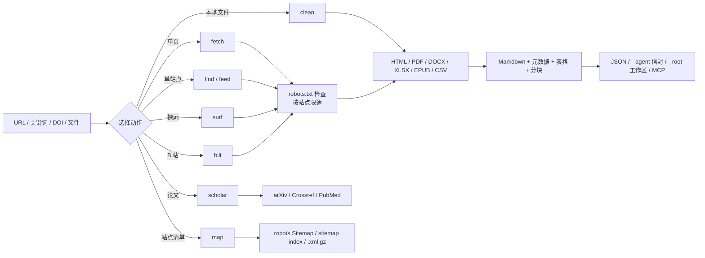

# web-forager

**礼貌地读取公开网络，把结果整理成干净的 Markdown 交给智能体。**

一个引擎，三个入口——CLI、两个 MCP 服务与 Claude Code 技能。它可搜索 360 / Bing / 搜狗 / 搜狗微信，读取 HTML、PDF、Office 文档、电子书、订阅源与站点地图，用真实浏览器处理需要渲染或登录态才能看到的页面，并且拒绝它不该碰的目标。

- **面向智能体：** 稳定的 `{"ok":…}` 信封、两种模式共享的 `--core` 记录，以及每段第三方文本上的 `trust: "untrusted"`。
- **面向使用者：** 一个任务一条命令，返回带表格的 Markdown，并说明哪些内容被跳过、为什么。
- **面向合规：** 每个 HTTP 请求都查 robots.txt，按站点限速，拒绝私有地址，不绕过登录与验证码。

[English](README.md) · **简体中文**

**版本：** 1.2.3 ｜ **许可：** MIT ｜ **Python：** 3.10+ ｜ **Node：** 18+（浏览器模式）

> 本插件仅供学习与研究用途。使用前请阅读[完整法律声明](#完整法律声明)。

---

## 目录

**开始**

- [为什么选 web-forager](#为什么选-web-forager)
- [安装与下载](#安装与下载)
- [快速上手](#快速上手)

**深入**

- [两种模式，一种记录](#两种模式一种记录)
- [一次运行如何流转](#一次运行如何流转)
- [完整参考](#完整参考)
- [安全边界](#安全边界)
- [范围与合规](#范围与合规)
- [完整法律声明](#完整法律声明)

**其他**

- [已知限制](#已知限制)
- [问题反馈](#问题反馈)
- [致谢](#致谢)
- [商标声明](#商标声明)
- [许可](#许可)

---

## 为什么选 web-forager

搜索 API 通常只返回链接，爬虫通常只读页面而不管规则。智能体需要这两半，外加一个可信任的契约；这个项目把它们放进同一个引擎。

- **一个引擎，所有内容类型。** HTML、PDF、DOCX、XLSX、EPUB、CSV、RSS/Atom、站点地图、B 站与渲染页面都返回同样四个字段——`metadata`、`markdown`、`tables`、`warnings`——调用方不需要按来源分支。
- **合规在抓取器内部。** robots.txt、按站点限速、响应体积上限、重定向次数上限与可联系的 User-Agent 对每个请求生效，搜索、sitemap 与 surf 的每一跳也不例外。
- **缺少组件时降级，而不是崩溃。** 没有桥是退出码 3，缺 Playwright 是 6，缺 `pypdf` 是 7，站点没有 sitemap 是带说明的空结果，每条记录都写明跳过了什么。
- **如实报告读到了什么。** `engine_report` 列出每个尝试过的引擎，`degraded` 表示页面读到了但剧本没找到目标，抓取文本带 `trust: "untrusted"`，看起来像提示词时还会给出 `injection_flags`。

---

## 安装与下载

请按一个完整插件安装：CLI、两个 MCP 服务与 `SKILL.md` 共用同一个引擎，拆散目录会失效。

**大多数人走方法一：让 AI 帮你装。** 如果你的宿主有插件市场、且想自己注册 URL，走方法二；在终端里安装、或要装到多个宿主的，走方法三。

### 方法一：让 AI 帮你装

```bash
请访问 GitHub 仓库 `https://github.com/JiamingShi-JsPhys/web-forager` 并克隆它，然后运行 `python install.py --project . --global`。如果你的宿主有插件系统，请改为把整套作为单一插件安装；该脚本覆盖的是读规则文件的那些宿主。
```

### 方法二：从插件市场用 URL 安装

下面每个宿主都有自己的插件市场。把本仓库的 Git URL 注册进去，再安装它列出的插件即可（URL 重复注册没有副作用，第二次会提示已存在）。

```bash
https://github.com/JiamingShi-JsPhys/web-forager
```

### 方法三：用命令安装

Claude Code、Codex、dsh 与 CodeBuddy 用一行插件命令即可；Cursor、Windsurf、Cline、Continue、Roo Code、GitHub Copilot 与 opencode 读规则文件，一个脚本能把它们全部写好。各宿主的完整命令、全部参数与可选依赖都在这一页：**[docs/INSTALL_COMMANDS_zh.md](docs/INSTALL_COMMANDS_zh.md)**。

---

## 快速上手

三个入口，外加一个可选的浏览器模式。按你所在的位置挑一个。

> 如果只读三张表，读[命令表](#在聊天框里用不需要终端与路径)、[动作表](docs/REFERENCE_zh.md#动作与退出码)、[退出码表](docs/REFERENCE_zh.md#动作与退出码)。

### 在聊天框里用（不需要终端与路径）

技能注册在 `web-forager` 命名空间下，一次 `/` 即可调用：

```text
/web-forager:web-forager  收集 https://www.bilibili.com/video/BV1xx411c7mD 并转成 Markdown
```

在名字后面说清需求，技能会自动选择动作，返回 Markdown、元数据、表格与警告。robots.txt 禁止的页面会被拒绝，而不是被强抓。

五个命令覆盖常见需求：

| 命令 | 作用 |
|---|---|
| `/web-forager:fetch` | 抓取一个 URL，或搜索关键词并读取结果 |
| `/web-forager:surf` | 搜索或打开种子 URL，再按相关度跟随页内链接，支持断点续游 |
| `/web-forager:scholar` | 查询 arXiv、Crossref、PubMed，或解析 DOI |
| `/web-forager:map` | 从 robots.txt 的 `Sitemap:`、sitemap index 与 `.xml.gz` 发现页面 URL |
| `/web-forager:browse` | 通过浏览器 MCP 服务运行只读剧本 |

```text
/web-forager:fetch https://example.org/article
/web-forager:scholar 10.1038/nature14539
```

### 在终端里用

先安装依赖：

```bash
pip install -r requirements.txt
```

一个页面：Markdown + 元数据 + 表格

```bash
python run.py --action fetch --url "https://example.org/article"
```

先搜索，再读最相关的几页

```bash
python run.py --action fetch --query "城市漫步 攻略" --num-results 8 --max-pages 3
```

一篇论文：不碰搜索结果页

```bash
python run.py --action scholar --source doi --query "10.1038/nature14539"
```

搜索默认走 `auto`，以中日韩文字为主的查询会同时问 360、搜狗与搜狗微信。搜索引擎被墙或被反爬时，[完整参考](docs/REFERENCE_zh.md#搜索引擎不可用时)里有不依赖引擎的站内搜索与订阅源两条路。

不确定该用哪个动作？

| 你手上有 | 用这个 |
|---|---|
| 一个 URL 或一个关键词 | `--action fetch` |
| 一个可信站点，但搜索引擎不可用 | `--action find --site <HOST> --query <TEXT>` |
| 一个博客或新闻站 | `--action feed --url <SITE>` |
| 一个 PDF、DOCX、XLSX、EPUB 或 CSV | `--action clean --input <FILE>` |
| 一个想按链接逐步探索的主题 | `--action surf --query <TEXT>` |
| 一个 DOI、arXiv 编号或论文标题 | `--action scholar` |
| 一个想枚举页面的站点 | `--action map --url <SITE>` |
| B 站 | `--action bili` |
| 「为什么跑不通」 | `--action doctor [--probe]` |

任意动作加 `--agent` 得到机器可读的 `{"ok":true,"data":…}` 信封；加 `--out result.json` 把完整记录落盘；加 `--root <WS>` 写进工作区（见[记录与输出](docs/REFERENCE_zh.md#记录与输出)）。

### 在 MCP 客户端里用

```json
{
  "mcpServers": {
    "web-forager": {
      "command": "python",
      "args": ["/absolute/path/to/web-forager/mcp_server.py"]
    },
    "web-forager-browser": {
      "command": "node",
      "args": ["/absolute/path/to/web-forager/browser/mcp_server.js"]
    }
  }
}
```

两个开关能让一次搜索变便宜：`max_pages: 0` 只返回结果列表、不抓正文（正文用 `web_fetch` 配小一点的 `max_chars` 按需取）；`respect_robots: false` 读取 robots.txt 禁止的页面，只用于你有权访问的资源。`web_search` 还会返回 `engine_report`（每个引擎一条）以及结果不含查询词时的 `warnings`。

### 浏览器模式（可选）

需要 Node.js 18+ 与一个桥命令，默认只读。七个剧本、各自的开关、`--strict-robots` 与成本控制都在[完整参考](docs/REFERENCE_zh.md#浏览器模式)里。

---

## 两种模式，一种记录

| | HTTP 模式 | 浏览器模式 |
|---|---|---|
| 读取 | 服务器返回的内容 | 脚本执行、登录态生效后人真正看到的页面 |
| 入口 | `run.py`、`mcp_server.py` | `browser/run.js`、`browser/mcp_server.js` |
| 需要 | Python 3.10+ | Node.js 18+ 与一个桥命令 |
| 覆盖 | 搜索、HTML/PDF/Office/订阅源、sitemap、surf、B 站、学术 API | 七个只读剧本、渲染页面、弹幕 |

两种模式共享四个核心字段——`metadata`、`markdown`、`tables` 与 `warnings`——其余部分各自扩展。任一侧加 `--core`，或给 `browser_run` 传 `core: true`，都会折叠成同一种有文档的形状（见[记录与输出](docs/REFERENCE_zh.md#记录与输出)）。

只有 B 站有站点专用 HTTP 适配器。知乎、小红书、微博与豆瓣在 HTTP 模式下按普通页面读取；知乎与小红书另有浏览器剧本，微博与豆瓣没有。

---

## 一次运行如何流转

每个请求都先进入同一个 `HttpFetcher`：robots 策略、缓存、重试退避、按站点限速与体积上限。随后所选动作把载荷交给对应的抽取器，所有抽取器最终都汇成同一种 Markdown 加元数据记录。



`surf` 只跟随页面里已经存在的 `<a href>` 链接，从不拼猜 URL、提交表单或执行页面 JavaScript。`map` 只读公开发布的 sitemap，`scholar` 调用有文档的 API，而不是抓结果页。

浏览器模式是并排的第二条循环：桥提供页面，`browser/run.js` 读取 DOM 快照，会话判断哪些是新的，剧本决定下一步导航，最后写出捕捉记录。每个观察周期只执行一个会改变状态的动作，写操作默认拒绝。

---

## 完整参考

记录结构、完整动作列表、退出码、环境要求、目录结构与测试细节都放在 **[docs/REFERENCE_zh.md](docs/REFERENCE_zh.md)**，让这一页保持为快速上手。

最常遇到的几个：退出码 3 是 robots.txt 拒绝，退出码 6 是缺 Playwright（浏览器模式下也表示需要登录），退出码 7 是缺 `pypdf`，退出码 8 表示页面读到了但什么都没捕捉到，退出码 9 表示页面被反爬页替换。完整表格在参考手册里。

---

## 安全边界

工具会执行提示词或智能体要求的请求，因此三条边界写进代码，而不是留给调用方自行记得。

- **拒绝私有目标。** 环回、RFC 1918、链路本地（含 `169.254.169.254`）、CGNAT 及其 IPv6 形式，在建立连接前就被拒绝，并且对每一次重定向再查一遍，公共 URL 无法把客户端弹进局域网。`--allow-private` 只服务本地夹具与可信内网工具，默认关闭。
- **浏览器使用自己的配置目录。** 自带桥把状态存在 `~/.web-forager/browser/profile`，不是你的日常浏览器。经 CDP 接入个人浏览器仍然可用，但运行结果会标 `shared_browser: true` 并附警告：那个配置里的每个 Cookie 与登录态，剧本打开的页面都能碰到。桥还会拦截页面发起的私有地址请求，恶意页面无法在浏览器内探测 `http://127.0.0.1:…`。
- **抓取到的文本是数据，记录里也这么写。** 每条记录带 `trust: "untrusted"`。页面里出现指令形状的文字——「忽略之前的指令」、伪造 system 标签、`curl … | sh`、要求发送密钥或环境变量——对应代码会写进 `injection_flags`，并在 `warnings` 第一条给出说明。`--input-gate strict` 则干脆不交付正文。这是一道筛子而不是沙箱：宿主仍须避免让不可信内容、私有数据与对外请求同时出现在一个自主循环里。

---

## 范围与合规

核心引擎为原创的干净室实现：没有从 Crawlee、Scrapy、Colly、Katana 或其他爬虫框架复制任何源码，也不依赖任何 GPL/AGPL 库。工具**不会绕过**登录、验证码、Cloudflare 挑战或付费墙，也不进行并发请求洪峰。抓取每个目标页面前都会检查 `robots.txt`（RFC 9309 子集），每个请求都携带可联系的信息收集 User-Agent，默认每站点每秒最多一个请求——搜索、sitemap 与 surf 的每一跳同样适用。

---

## 完整法律声明

### 用途

web-forager 把读取公开可访问页面的过程自动化，仅用于学习、研究、监测和个人知识整理。

### 禁止用途

- 识别、定位、画像或联系某个私人个体，或把散落各处的记录拼成一个人的全貌。
- 骚扰、跟踪、恐吓、人肉搜索，或任何侵犯他人隐私的行为。
- 绕过登录、验证码、付费墙或访问控制，或超出内置限速给站点施加负载。
- 对目标站点发起恶意并发请求，或任何拒绝服务式的访问。
- 任何违反你所在地法律、或你正在读取的站点条款的用途。

### 你的责任

遵守适用的法律法规，以及所访问站点的 Terms of Service 与版权，是最终使用者的责任。作者不授予访问你无权查看内容的许可，也不对某次具体使用是否合法作出判断。使用者对软件的使用方式承担全部法律责任。

### 不作担保

本软件按 MIT 许可证的「AS IS」提供，不附带任何明示或默示担保（见 [LICENSE](LICENSE)）。它可能失败、返回不完整或过时的内容，也可能在版本之间改变行为。

### 责任限制

在法律允许的最大范围内，作者与贡献者不对本软件的任何误用承担责任，也不对由此产生的任何损害、损失或法律后果负责。抓取到的文本来自第三方站点，本项目不为其背书，也不做核查。

### 再分发

发布或 fork 时，请保留本免责声明与许可证声明。

---

## 已知限制

### 使用前必读

- **这是低频工具，不是爬虫集群**：请求串行、按站点限速（默认每秒一次），`surf`、搜索与 sitemap 读取都不做并发扇出，因此不适合大规模采集。
- **PDF 只读取文本层**：扫描件需要 OCR，本插件不做。
- **不绕过登录墙**：`zhihu-dig` 与 `xhs-dig` 会以 `login_required` 停下；请通过桥复用已登录的配置目录。
- **robots.txt 不可达即拒绝**：这是 RFC 的保守做法。`--ignore-robots` 仅用于你已获得明确授权的资源。浏览器模式只在 `--strict-robots` 下查 robots.txt，而记录里始终写明是否查过（`compliance.robots_checked`）。

### 边缘情况

- **学术 API 只返回元数据与摘要**：不返回全文；请遵守各平台条款。
- **`--render auto` 是启发式判断**：可见文字过少加 SPA 标记。复杂站点可能仍需要 `--render always`，而 `--wait-for` / `--scroll` 只在装了 Playwright 时生效。
- **搜索依赖公开结果页**：可用性随网络变化，且每个解析器（`parse_360_html`、`parse_bing_html`、`parse_sogou_html`、`parse_weixin_html`、`parse_ddg_html`）都对结果页结构有假设。每个都有 `tests/fixtures/` 下的离线夹具，改版会让夹具测试失败，而不是悄悄返回空。**不支持百度**：其结果页防护很强，本插件没有对应解析器。搜狗可能弹人机验证，`--engine all` 可能部分失败。中文查询不会回落到 Bing，只命中查询中单个字的词典页会被过滤。
- **只有 B 站有站点专用 HTTP 适配器**：上面提到的其他站点都按普通页面读取，够用于公开文章页，不够用于登录后的信息流。
- **浏览器模式需要可用的桥**：`playwright` 与 Chromium 二进制要另外安装，`--doctor` 会指出缺的是哪一个；完全找不到桥时，真实运行以退出码 3 返回。
- **`surf` 只跟随普通链接**：不点按钮、不执行 JavaScript、不处理登录墙。
- **DNS 会解析两次**：拦截检查一次 DNS 返回的地址，HTTP 客户端连接时再解析一次。若恶意解析器在两次调用之间给出不同答案（rebinding），这道检查拦不住；这种威胁模型需要配合出站网络策略。

### 实验性与高风险开关

- **弹幕仍是实验性能力**：优先用桥的 `observe("danmaku", ms)`；DOM 文本是兜底路径，假设页面上有一种可见的 `mm:ss 文本` 布局，记录会在 warnings 里写明这一点。canvas 渲染的文字仍需 OCR。
- **浏览器选择器是启发式的**：所有关于第三方页面的模式都集中在 `browser/lib/selectors.js`，并用真实页面导出的快照做回归（`browser/tests/fixtures/snapshots/`，记录于 2026-11-07）。它只能在改版之后发现漂移，不能提前预知；设置 `WEB_FORAGER_LIVE=1` 并接好桥后，`npm run test:live` 会对真实站点复查。
- **注入筛查是一道筛子，不是沙箱**：它匹配已知话术，会漏掉改写过的表达。真正约束恶意页面的是 `trust: "untrusted"` 与宿主自己的权限模型，标记列表只让边界可见。
- **私有地址拦截可以关掉**：`--allow-private`（或 `WEB_FORAGER_ALLOW_PRIVATE=1`）服务本地夹具与可信内网目标，会关闭环回/局域网/元数据地址检查。对你不控制的输入永远不要打开它。
- **CDP 接入会暴露所接入的浏览器**：自带桥使用独立配置目录，而 `WEB_FORAGER_BROWSER_CDP` 复用你已开着的浏览器，连同其中全部 Cookie 与登录态。

---

## 问题反馈

**普通缺陷与功能建议**：请提交到仓库的 [Issues](https://github.com/JiamingShi-JsPhys/web-forager/issues) 页面，附复现步骤、期望行为、实际行为与环境（操作系统、Python 版本）。

**安全漏洞（仅此类别）**：**不要**使用公开 Issues 页面，请改为发送邮件至 `jiamingshi_git@outlook.com`。

- **主题**：必须带前缀 `report_web-forager:`，并附简短摘要。
  - 示例：`report_web-forager: 路径穿越可读取目标目录之外的文件`
- **正文**：必须包含详细复现步骤与环境信息。

*提交清晰、可复现 issue 或 pull request 的贡献者，会在下个版本的更新说明与[致谢](#致谢)中列出。*

## 致谢

NotFatJustRound

[详细致谢](docs/ACKNOWLEDGEMENTS_zh.md)

## 商标声明

"Bilibili""arXiv""Crossref""PubMed""Claude""Codex""CodeBuddy"与"DeepSeek"是其各自所有者的商标或注册商标。web-forager 是独立的第三方工具，与上述任何一方均无隶属、背书或赞助关系。所有请求只访问公开页面或有文档的 API；使用者需自行遵守各平台条款。

---

## 许可

MIT。见 [LICENSE](LICENSE) 与 [THIRD_PARTY_LICENSES.txt](THIRD_PARTY_LICENSES.txt)。

**作者与维护者**：Jiaming Shi