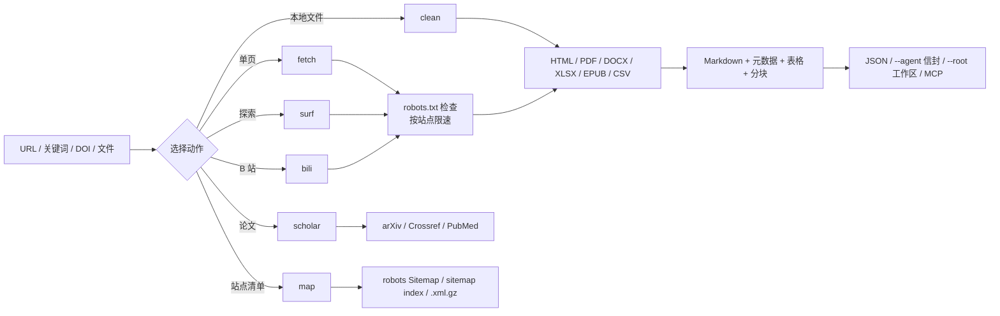

# web-forager

> **一个干净室实现、遵守 robots.txt 的网络信息收集工具，面向智能体与分析者：提供 CLI、两个 MCP 服务与 Claude Code 技能。**>
> 它有两种模式。**HTTP 模式**用 360 / Bing / Sogou / 搜狗微信 搜索，读取 HTML、PDF、DOCX、XLSX、EPUB、CSV 与 RSS/Atom，通过专用适配器收集 B 站公开页面，并通过通用 HTML 管线读取新闻站点、博客与论坛，发现站点地图，把长文切成适合上下文的块，礼貌地缓存响应，并能像人一样沿页面链接自主冲浪、断点续游；可选的学术查询覆盖 arXiv、Crossref、PubMed 与 DOI。**浏览器模式**通过可插拔的桥驱动真实浏览器，处理登录态页面、渲染内容与 B 站弹幕，内置七个只读剧本，覆盖 B 站、知乎与小红书。HTTP 的每一次访问都先检查 robots.txt，并按站点限速；浏览器模式会如实记录是否查过 robots.txt。

> ## 免责声明（务必阅读）
>
> **本插件仅供学习与信息收集使用。使用者需遵守目标网站的 Terms of Service 及相关版权法律。禁止用于恶意并发攻击。严禁收集、聚合或推断特定自然人的个人信息，或将其用于人肉搜索、骚扰、跟踪等侵害他人隐私的活动；此类用法产生的法律责任由使用者自行承担。**

[English](README.md) · **简体中文**

**版本：** 1.2.0 ｜ **CLI 动作：** 9 ｜ **MCP 工具：** 10 ｜ **浏览器剧本：** 7

---

## 安全与开源声明

> **免责声明**：本插件是为公开网络信息收集而开发的辅助工具，不是经过同行评议的研究项目。核心引擎为原创的干净室实现：没有从 Crawlee、Scrapy、Colly、Katana 或其他爬虫框架复制任何源码。
>
> 工具**不会绕过**登录、验证码、Cloudflare 挑战或付费墙，不以个人数据为目标，也不进行并发请求洪峰；用它拼出一个可识别个人的画像，为上面的免责声明所禁止。每次抓取目标页面前都会检查 `robots.txt`，每个请求都携带可联系的信息收集 User-Agent，默认每站点每秒最多一个请求。
>
> 抓取到的文本来自第三方站点，本插件不对其内容以及由使用该内容产生的后果负责。

---

## 为什么选 web-forager？

当前的智能体生态里，工具通常只解决一半问题：搜索 API 只给链接，没有阅读管线；爬虫只读页面，没有合规层。两者都没有为“检索”与“消费检索结果的智能体”之间提供稳定契约。web-forager 把两半放进同一个引擎。典型用途包括：跟踪 B 站、知乎、小红书上的话题，收集文章与公开讨论，以及搭建个人知识库。

**一个引擎服务所有来源。** HTML、PDF、Office 文档、电子书、订阅源、站点地图、B 站与普通网页都返回同样的四个核心字段：`metadata`、`markdown`、`tables` 与 `warnings`。调用方不需要为每种内容类型写不同的代码路径。只有 B 站有站点专用的 HTTP 适配器；知乎与小红书由浏览器剧本覆盖，微博、豆瓣等站点则当作普通页面读取，没有任何站点专用代码。`--core` 把两种模式折叠成同一种记录，混合结果列表因此保持统一。

**合规内建在抓取器里，而不是事后补丁。** robots.txt（RFC 9309 子集）、按站点限速、响应体上限、重定向上限和明确的信息收集 User-Agent 对每个请求生效，搜索、sitemap 与 surf 的每一跳也不例外。

**面向智能体的接口会降级，不会崩溃。** `--agent` 给出稳定的 `{"ok":…}` 信封，`mcp_server.py` 暴露 10 个 MCP 工具，`browser/mcp_server.js` 再暴露 4 个，`--chunk-size` 按标题切分长文。缺少 Playwright 返回退出码 6，缺少 `pypdf` 返回退出码 7，站点没有 sitemap 则返回空结果并附说明。

**两种模式覆盖网络的两半。** HTTP 模式读取服务器返回的内容：快、可审计、遵守 robots。浏览器模式读取人真正看到的页面：脚本已执行、登录态生效、播放器已挂载。它不内置浏览器，只启动桥命令，并用一套很小的 JSON-RPC 协议与它通信。`browser/bridges/` 里自带的桥会被自动启用；`--bridge` 或 `WEB_FORAGER_BRIDGE` 可指向别处的桥。一个桥都找不到时，真实浏览器运行以退出码 3 停下，而不是假装读过页面。两种模式共享四个核心记录字段，其余部分各自扩展；任一侧加上 `--core` 都会返回共享形状（见 [记录](#记录)）。

---

## 一次运行如何流转

每个请求都先进入同一个 `HttpFetcher`：robots 策略、缓存、重试退避、按站点限速与体积上限。随后所选动作把载荷交给对应的抽取器，所有抽取器最终都汇成同一种 Markdown 加元数据记录。



`surf` 只跟随页面里已经存在的 `<a href>` 链接，从不拼猜 URL、提交表单或执行页面 JavaScript。`map` 只读公开发布的 sitemap，可选学术查询调用有文档的 API，而不是抓结果页。

浏览器模式是并排的第二条循环：桥提供页面，`browser/run.js` 读取 DOM 快照，会话判断哪些是新的，剧本决定下一步导航，最后写出捕捉记录。每个观察周期只执行一个会改变状态的动作，写操作默认拒绝。

---

## 安装与下载

请按一个完整插件安装：CLI、两个 MCP 服务与 `SKILL.md` 共用同一个引擎，拆散目录会失效。

### 方法一：从插件市场用 URL 安装

下面每个宿主都有自己的插件市场。把本仓库的 Git URL 注册进去，再安装它列出的插件即可（URL 重复注册没有副作用，第二次会提示已存在）。

```bash
https://github.com/JiamingShi-JsPhys/web-forager
```

### 方法二：用命令安装

Claude Code、Codex、dsh 与 CodeBuddy 用一行插件命令即可；Cursor、Windsurf、Cline、Continue、Roo Code、GitHub Copilot 与 opencode 读规则文件，一个脚本能把它们全部写好。各宿主的完整命令、全部参数与可选依赖都在这一页：**[docs/INSTALL_COMMANDS_zh.md](docs/INSTALL_COMMANDS_zh.md)**。

### 方法三：让 AI 帮你装

```bash
请访问 GitHub 仓库 `https://github.com/JiamingShi-JsPhys/web-forager` 并克隆它，然后运行 `python install.py --project . --global`。如果你的宿主有插件系统，请改为把整套作为单一插件安装；该脚本覆盖的是读规则文件的那些宿主。
```

> **警告**：使用 AI 自动安装时，AI 有概率会把 `scripts/`、`run.py` 与 `SKILL.md` 打散，复制到无关目录中。模块之间互相导入，MCP 服务也假定插件内的相对布局，散装副本会直接失效。如果你需要完整的插件功能，请使用方法一。

---

## 快速上手

安装插件后留在聊天框里：输入 `/`，选择技能或命令。不需要终端，不需要绝对路径——你当前工作的文件夹就是工作区。

### 技能

技能注册在 `web-forager` 命名空间下，一次 `/` 即可调用：

```text
/web-forager:web-forager  收集 https://www.bilibili.com/video/BV1xx411c7mD 并转成 Markdown
```

在名字后面说清需求，技能会自动选择动作，返回 Markdown、元数据、表格与警告。robots.txt 禁止的页面会被拒绝，而不是被强抓。

### 插件命令

五个命令把常用动作收进一行：

| 命令 | 作用 |
|---|---|
| `/web-forager:fetch` | 抓取一个 URL，或搜索关键词并读取结果 |
| `/web-forager:surf` | 搜索或打开种子 URL，再按相关度跟随页内链接，支持断点续游 |
| `/web-forager:scholar` | 查询 arXiv、Crossref、PubMed，或解析 DOI |
| `/web-forager:map` | 从 robots.txt 的 `Sitemap:`、sitemap index 与 `.xml.gz` 发现页面 URL |
| `/web-forager:browse` | 通过浏览器桥读取渲染页面、登录态站点、B 站弹幕等七类剧本 |

```text
/web-forager:fetch https://example.org/article
/web-forager:scholar 10.1038/nature14539
```

默认搜索走 `auto`；以中日韩文字为主的查询会同时问 360、搜狗与搜狗微信。
`--engine weixin` 直接查微信公众号文章索引——中文人名或机构名通常只有这条渠道有内容。

### 浏览器模式

浏览器层位于 `browser/`，需要 Node.js 18 或更新。它默认只读：点赞、投币、
收藏、关注、分享、评论、弹幕与发布一律拒绝，除非用户明确授权某一次动作后
传入 `--allow-write`。

```bash
node browser/run.js --list
node browser/run.js --doctor
node browser/run.js --playbook bili-feed --session bili-01 --max-items 8 --agent
node browser/run.js --playbook bili-video --url "https://www.bilibili.com/video/BV1xx411c7mD"
node browser/run.js --playbook bili-chain --url "https://www.bilibili.com/video/BV1xx411c7mD"
node browser/run.js --playbook bili-danmaku --url "https://www.bilibili.com/video/BV1xx411c7mD"
node browser/run.js --playbook zhihu-dig --query "强化学习" --agent
node browser/run.js --playbook xhs-dig --query "城市漫步 攻略" --agent
node browser/run.js --playbook search-dig --query "强化学习" --agent
node browser/run.js --playbook bili-feed --dry-run
```

装好 `playwright` 与它的 Chromium 后，自带的桥会被自动启用；`--bridge` 或
`WEB_FORAGER_BRIDGE` 用于指向别处的桥：

```bash
npm install playwright && npx playwright install chromium
node browser/run.js --playbook bili-feed --doctor   # 说明还缺什么
```

`WEB_FORAGER_BROWSER_HEADFUL=1` 显示窗口；
`WEB_FORAGER_BROWSER_PROFILE=/path` 复用持久化配置目录（`extension` 后端的
登录态正是靠它保留）；`WEB_FORAGER_BROWSER_CDP=http://127.0.0.1:9222` 接管你
已有的浏览器（`cdp`）。后端名只是标记，真正决定能力的是桥：桥通过可选的
`describe` 调用声明自己实现了什么，运行结果里的 `backend.capabilities`
原样记录这份声明。不实现 `describe` 的桥会被标记为 `declared: false`，
所有能力一律为 false，因此剧本不会假设桥做不到的调用。

`--strict-robots` 在每次导航前读取 `robots.txt`，被禁止的路径以
`robots_denied`（退出码 3）停下。不加这个开关时记录同样说清楚：
`compliance.robots_checked` 为 `false`，并附一句说明本次没有检查。读到了页面
却什么也没找到——空信息流、没有结果卡片、空白页——会报告 `degraded`
（退出码 8）并附上已写出的记录，而不是给出 `ok: true` 与 `captured: 0`。
反爬或错误页以 `blocked`（退出码 9）停下。这两种都与 `login_required`
（退出码 6，站点要求登录）区分开。

| 剧本 | 作用 | 需要 |
|---|---|---|
| `bili-feed` | 首页信息流，逐屏捕捉未见卡片 | 无 |
| `bili-video` | 单个视频与可见评论 | `--url` 或 `--bvid` |
| `bili-chain` | 跟随“下一话”，并从会话续接链路 | `--url`、`--bvid` 或会话链路 |
| `bili-danmaku` | 带时间戳的弹幕，优先用桥的 `observe`，DOM 文本兜底（实验性） | `--url` 或 `--bvid` |
| `zhihu-dig` | 搜知乎、排序链接、捕捉最佳未见页面 | `--query` |
| `xhs-dig` | 搜小红书公开笔记、排序 `/explore` 链接、捕捉一条 | `--query` |
| `search-dig` | 搜 B 站、排序卡片、打开最佳未见结果 | `--query` |

平台用登录墙代替结果时，`zhihu-dig` 与 `xhs-dig` 会以 `login_required`
（退出码 6）停下，绝不尝试绕过。

#### 把浏览器模式的代价压下来

浏览器模式是插件里最贵的一环，默认值刻意开得很小，几个省钱开关值得记住：

- **记录落盘。** CLI 用 `--out result.json`，MCP 传 `out: "C:/path/result.json"`，
  完整记录写进文件，上下文只收一段摘要；刷十屏也不会把正文灌进对话。
- **默认不截图。** 剧本抓的是文字不是像素；一张截图的开销约等于一整页正文。
  只有"布局本身就是要问的问题"时才单独要一张。
- **保持礼貌。** 值得守的上限是 `--max-screens 5` 和 `--min-interval 3000`
  （默认分别是 3 屏和 1000 毫秒）。长时间刷屏宁可用 `--session` 分几次续跑。
- **弹幕仍是实验性的。** `bili-danmaku` 优先用桥的 `observe`，退回 DOM 文本时
  会标 `partial` 警告；当数据用之前先小样本核对。
- **登录态来自你自己开着的浏览器。** 用
  `--remote-debugging-port=9222` 启动 Chrome，把 `WEB_FORAGER_BROWSER_CDP`
  指向它并传 `--backend cdp`；持久化配置目录（`WEB_FORAGER_BROWSER_PROFILE`）
  也能跨多次运行保留登录态。`extension` 后端只是给扩展桥预留的位置，本仓库
  不附带该扩展。

### MCP 服务

```json
{
  "mcpServers": {
    "web-forager": {
      "command": "python",
      "args": ["/absolute/path/to/web-forager/mcp_server.py"]
    },
    "web-forager-browser": {
      "command": "node",
      "args": ["/absolute/path/to/web-forager/browser/mcp_server.js"]
    }
  }
}
```

HTTP 工具：`web_fetch`、`web_search`、`web_surf`、`web_scholar`、`web_map`、
`web_bilibili`、`web_clean`、`web_doctor`、`web_find`、`web_feed`。浏览器工具：
`browser_list`、`browser_run`、`browser_session`、`browser_doctor`。直接测试协议：
两个开关能让一次搜索变便宜：`max_pages: 0` 只返回结果列表、不抓正文（正文用
`web_fetch` 配小一点的 `max_chars` 按需取）；`respect_robots: false` 读取
robots.txt 禁止的页面，只用于你有权访问的资源。结果完全不含查询词的搜索会在
`warnings` 里明说。


```bash
printf '%s\n' '{"jsonrpc":"2.0","id":1,"method":"initialize","params":{}}' \
  '{"jsonrpc":"2.0","id":2,"method":"tools/list"}' | python mcp_server.py
```

```bash
printf '%s\n' '{"jsonrpc":"2.0","id":1,"method":"initialize","params":{}}' \
  '{"jsonrpc":"2.0","id":2,"method":"tools/list"}' | node browser/mcp_server.js
```

### 工作区输出

```bash
python run.py --action fetch --url "https://example.org/article" --root <WS>
```

只写这些位置：

```text
<WS>/process/web-forager/web-forager_<timestamp>_<slug>.json
<WS>/process/web-forager/web-forager_<timestamp>_<slug>.md
<WS>/_broadcast/web-forager_<timestamp>_<slug>.json
```

`material/` 与 `results/` 属于用户与编排器，web-forager 从不写入。

浏览器捕捉遵循同一套规则：

```text
<WS>/process/web-forager/browser/web-forager-browser_<timestamp>_<slug>.json
<WS>/process/web-forager/browser/web-forager-browser_<timestamp>_<slug>.md
<WS>/_broadcast/web-forager-browser_<timestamp>_<slug>.json
```

### 记录

两种模式在检索核心上一致，其余部分不同。下面是逐字段的真实对照，而不是“记录相同”的说法：

| 字段 | HTTP 模式 | 浏览器模式 |
|---|---|---|
| `metadata`、`markdown`、`tables`、`warnings` | 有 | 有 |
| `url`、`title` | 有（`url` 与 `final_url`） | 有 |
| `status`、`content_type`、`document_kind`、`cached`、`rendered`、`fetched_at`、`chunks`、`links` | 有 | 无 |
| `schema_version`、`captured_at`、`playbook`、`backend`、`compliance`、`viewport_evidence`、`interaction_trace` | 无 | 有 |

任一侧 CLI 加 `--core`，或 `browser_run` 传 `core: true`，返回的都是共享形状。
此时每条记录恰好只有这些键：

```json
{
  "schema_version": "core-1",
  "source": "web-forager",
  "mode": "http",
  "url": "https://example.org/article",
  "title": "An article",
  "collected_at": "2026-11-07T10:00:00Z",
  "metadata": {},
  "markdown": "...",
  "tables": [],
  "warnings": [],
  "extra": { "status": 200, "cached": false }
}
```

`mode` 为 `http` 或 `browser`，`source` 标明产出方，`extra` 保留两种模式不共享的
全部字段，因此不会丢信息。同样的折叠也提供库调用：Python 侧是
`engine.normalize_record()`，浏览器侧是 `browser/lib/record.js` 的 `normalizeRecord()`。

### 需要命令行时

同样的操作可以在脚本与 CI 中无头运行：

```bash
python run.py --action fetch --url "https://www.bilibili.com/video/BV1xx411c7mD"
python run.py --action fetch --url "https://www.zhihu.com/" --render auto
python run.py --action fetch --url "https://www.xiaohongshu.com/explore" --render auto
python run.py --action fetch --query "城市漫步 攻略" --num-results 8 --max-pages 3
python run.py --action surf --url "https://www.zhihu.com/" --depth 1 --max-pages 5 --session zhihu-01
python run.py --action clean --input notes.pdf --format markdown
python run.py --action map --url "https://example.org" --limit 500
python run.py --action bili --mode feed --max-items 10
```

---

### 响应结构

`results` 是给智能体循环用的索引，不是每页正文的第二份拷贝。搜索时它只带
`url`、`title`、`snippet`、`status`、`content_type`、`markdown_chars`、`tables`
以及可能的 `warnings` 或 `error`；Markdown 正文只在 `pages` 里出现一次，单页
`fetch` 则把它放在顶层。要旧行为（`results` 重复整份记录）加 `--full-results`
（CLI）或 `fullResults: true`（MCP）。

`--action doctor` 会逐项报告依赖的版本或安装命令，智能体拿到单薄页面时可以先
自检再补装。


### HTTP 模式该什么时候用

一般的搜索工具已经覆盖了 `web_search` 与 `web_fetch`。它覆盖不到的是两块：
`web_scholar`（arXiv / Crossref / PubMed / DOI 记录）和 `web_map`（从 robots.txt
与 sitemap 发现页面 URL）。当搜索工具够用时，不必为了这两块去用整套插件。

### 搜索引擎被墙或被反爬时

有些网络会用词典页、验证页或超时来回答搜索。两条路不依赖任何引擎：

```bash
python run.py --action find --site the-decoder.com --query "OpenAI watermark" --max-pages 3
python run.py --action feed --url https://the-decoder.com/ --num-results 10
```

`find` 会依次尝试站点自己的搜索地址（`/?s=`、`/search?q=` 等四种），按查询词给
链接排序再抓最相关的几篇；`feed` 从页面里找到 RSS/Atom 的
`<link rel=alternate>` 并读取。`doctor --probe` 会把每个引擎各问一次，报告当前
网络下哪些答得上来，把“搜索坏了”变成一条可核对的事实。

请求默认遵循 `HTTPS_PROXY` / `ALL_PROXY`；`--proxy URL` 可为单次运行覆盖它们。
`doctor` 会报告当前使用的代理，并隐去其中的账号密码。

## 动作与退出码

| 动作 | 用途 |
|---|---|
| `fetch` | 一个 URL 或关键词查询 → 页面 |
| `find` | 用站点自己的搜索页在站内检索 |
| `feed` | 读取站点的 RSS/Atom，自动从页面里发现订阅地址 |
| `clean` | 本地或远程 HTML/PDF/DOCX/XLSX/EPUB/CSV → Markdown |
| `bili` | B 站首页 / 视频 / 相关 / 搜索 / 冲浪 |
| `surf` | 搜索或种子 URL，再按相关度做链接 BFS |
| `scholar` | arXiv / Crossref / PubMed / DOI 记录 |
| `map` | 从 robots.txt 与 sitemap 发现页面 URL |
| `doctor` | 依赖自检：装了什么，该装什么 |

| 退出码 | 含义 |
|---|---|
| 0 | 成功 |
| 2 | 参数或 URL 错误 |
| 3 | robots.txt 拒绝访问 |
| 4 | 网络 / HTTP 失败 |
| 5 | 抽取失败 |
| 6 | 请求了 Playwright 但不可用 |
| 7 | 处理 PDF 但 `pypdf` 不可用 |
| 130 | 被中断 |

浏览器模式在含义相通处沿用这些退出码，并多出两种：

| 退出码 | 浏览器模式含义 |
|---|---|
| 2 | 参数错误，或未知后端 |
| 3 | `--strict-robots` 下被 `robots_denied`，或没有配置桥 |
| 4 | 导航失败 |
| 5 | 捕捉失败 |
| 6 | `login_required`：站点要求登录 |
| 7 | `confirmation_required`：写类操作被拒绝 |
| 8 | `degraded`：页面读到了，但剧本要的东西一个都没找到 |
| 9 | `blocked`：页面被反爬或错误页替换 |
| 130 | 被中断 |

`--agent` 保留这些退出码，并在 stdout 输出 `{"ok":false,"error":{"code","message","hint"}}` 信封。

---

## 环境要求

Python 3.10+。核心运行时：`requests`、`beautifulsoup4`、`trafilatura`。可选：`playwright`（JS 渲染）、`pypdf`（PDF）。`defusedxml` 若已安装则使用，但从不强制依赖——含内部 DTD 子集或任何 ENTITY 声明的 XML 一律拒绝。浏览器模式另需 Node.js 18+ 与一个桥命令；`browser/bridges/playwright-bridge.js` 还需要 npm 安装 `playwright`。没有内置任何第三方代码；每个库都保留自己的宽松许可证。不使用任何 GPL/AGPL 依赖。完整的能力-依赖矩阵见 [docs/DEPENDENCIES.md](docs/DEPENDENCIES.md)。

---

## 目录结构

```text
web-forager/
├── .claude-plugin/               Claude Code 清单 + marketplace
├── .codex-plugin/                Codex 清单 + marketplace
├── .codebuddy-plugin/            CodeBuddy 清单 + marketplace
├── .dsh-plugin/                  DSH 清单 + CJS 入口
├── .cursor/rules/                Cursor 规则
├── .windsurf/rules/              Windsurf 规则
├── .clinerules/                  Cline 规则
├── .continue/rules/              Continue 规则
├── .roo/rules/                   Roo Code 规则
├── .github/                      GitHub Copilot 指令
├── AGENTS.md                     通用智能体契约
├── install.py                    一键安装规则文件
├── manifest.json                 插件清单
├── .mcp.json                     MCP stdio 注册
├── package.json / index.js       npm + dsh 打包
├── cordis.patch.yml              dsh bundle 补丁
├── run.py                        CLI：fetch / clean / bili / surf / scholar / map
├── mcp_server.py                 MCP stdio 服务（8 个 HTTP 工具）
├── browser/                      浏览器模式（Node 18+）
│   ├── run.js                    CLI：七个只读剧本
│   ├── mcp_server.js             MCP stdio 服务（3 个浏览器工具）
│   ├── lib/                      桥后端、会话、记录、安全门禁、选择器、robots、快照
│   ├── playbooks/                bili-* / zhihu-dig / xhs-dig / search-dig
│   ├── bridges/                  可选 Playwright 参考桥
│   └── tests/                    假后端、真实页面快照、live 冒烟（55 个测试）
├── SKILL.md                      Claude Code 技能契约
├── commands/                     /fetch /surf /scholar /map /browse
├── docs/DEPENDENCIES.md          各能力依赖矩阵
├── scripts/
│   ├── engine.py                 robots、抓取、搜索、缓存、分块、Markdown、surf
│   ├── pdf.py                    PDF 文本（可选 pypdf）
│   ├── documents.py              DOCX / XLSX / EPUB / CSV
│   ├── feeds.py                  RSS / Atom / RSS 1.0
│   ├── scholar.py                arXiv / Crossref / PubMed / DOI
│   ├── sitemap.py                sitemap 发现
│   └── bilibili.py               B 站适配器
├── tests/                        # 离线 HTTP 夹具（137 个测试）
├── requirements.txt
├── THIRD_PARTY_LICENSES.txt
├── CHANGELOG.md
├── README.md · README_zh.md
└── LICENSE                       MIT
```

---

## 测试

```bash
python -m pytest tests -q
npm run test:browser
```

共 **137 个 Python 测试**加 **55 个浏览器测试**，全部通过且完全离线。`conftest.py` 会启动一个临时本地 HTTP 服务，提供 robots.txt、文章、PDF/Office 文件、订阅源、sitemap、搜索结果页与多跳 surf 页面。Python 套件覆盖 robots 拒绝、正文抽取、表格、文档、订阅源、缓存、搜索翻页、分块、MCP、surf 会话、安装器行为、宿主规则与免责声明检查、共享的 `core-1` 记录，以及全部退出码。浏览器套件使用假后端与说同一套协议的假桥，因此不装浏览器也能端到端跑完 CLI；它还覆盖能力声明、robots.txt 匹配、`--strict-robots` 往返，以及基于真实页面快照的 degraded 与 blocked 路径。

真实站点检查是可选项，CI 从不运行：

```bash
WEB_FORAGER_LIVE=1 WEB_FORAGER_BRIDGE="node browser/bridges/playwright-bridge.js" npm run test:live
```

---

## 已知限制

以下是诚实的边界情况，依赖任何输出前请先读：

- **这是低频工具，不是爬虫集群**：请求串行、按站点限速（默认每秒一次），`surf`、搜索与 sitemap 读取都不做并发扇出。这是设计选择，也意味着 web-forager 不适合大规模采集。
- **PDF 只读取文本层**：扫描件需要 OCR，本插件不做。
- **学术 API 只返回元数据与摘要**：不返回全文；请遵守各平台条款。
- **`--render auto` 是启发式判断**：可见文字过少加 SPA 标记。复杂站点可能仍需要 `--render always`，而 `--wait-for` / `--scroll` 只在装了 Playwright 时生效。
- **搜索依赖公开结果页**：可用性随网络变化，且每个解析器（`parse_360_html`、`parse_bing_html`、`parse_sogou_html`、`parse_weixin_html`、`parse_ddg_html`）都对结果页结构有假设。每个都有 `tests/fixtures/` 下的离线夹具，改版会让夹具测试失败，而不是悄悄返回空。**不支持百度**：其结果页防护很强，本插件没有对应解析器。搜狗可能弹人机验证；对以中日韩文字为主的查询，`auto` 先问 360、搜狗与搜狗微信，三者都失败才回落 Bing，`--engine all` 可能部分失败。
- **只有 B 站有站点专用 HTTP 适配器**：HTTP 模式下知乎、小红书、微博、豆瓣都按普通 HTML 页面读取，够用于公开文章页，不够用于登录后的信息流。知乎与小红书另有浏览器剧本，微博与豆瓣没有。
- **B 站 HTTP 模式只读公开页面**：不登录、不抓评论、不抓字幕、不访问私密列表。
- **浏览器模式需要可用的桥**：自带 Playwright 桥会被自动找到，但 `playwright` 与 Chromium 二进制要另外安装；`--doctor` 会指出缺的是哪一个。完全找不到桥时，真实运行以退出码 3 返回。
- **浏览器模式默认只读**：除非用户明确授权后传入 `--allow-write`，写操作一律拒绝。
- **浏览器选择器是启发式的**：所有关于第三方页面的模式都集中在 `browser/lib/selectors.js`，并用真实页面导出的快照做回归（`browser/tests/fixtures/snapshots/`，记录于 2026-11-07）。它只能在改版之后发现漂移，不能提前预知。设置 `WEB_FORAGER_LIVE=1` 并接好桥后，`npm run test:live` 会对真实站点复查。
- **弹幕仍是实验性能力**：优先用桥的 `observe("danmaku", ms)`；DOM 文本是兜底路径，假设页面上有一种可见的 `mm:ss 文本` 布局，记录会在 warnings 里写明这一点。canvas 渲染的文字仍需 OCR。
- **不绕过登录墙**：`zhihu-dig` 与 `xhs-dig` 会以 `login_required` 停下；请通过桥复用已登录的配置目录。
- **`surf` 只跟随普通链接**：不点按钮、不执行 JavaScript、不处理登录墙。
- **robots.txt 不可达即拒绝**：这是 RFC 的保守做法。`--ignore-robots` 仅用于你已获得明确授权的资源。浏览器模式只在 `--strict-robots` 下查 robots.txt，而记录里始终写明是否查过（`compliance.robots_checked`）。

---

## 问题反馈

**普通缺陷与功能建议**：请提交到仓库的 [Issues](https://github.com/JiamingShi-JsPhys/web-forager/issues) 页面，附复现步骤、期望行为、实际行为与环境（操作系统、Python 版本）。

**安全漏洞（仅此类别）**：**不要**使用公开 Issues 页面，请改为发送邮件至 `jiamingshi_git@outlook.com`。

- **主题**：必须带前缀 `report_web-forager:`，并附简短摘要。
  - 示例：`report_web-forager: 路径穿越可读取目标目录之外的文件`
- **正文**：必须包含详细复现步骤与环境信息。

*提交清晰、可复现 issue 或 pull request 的贡献者，会在下个版本的更新说明与[致谢](#致谢)中列出。*

## 致谢

NotFatJustRound

[详细致谢](docs/ACKNOWLEDGEMENTS_zh.md)

## 商标声明

“Bilibili”“arXiv”“Crossref”“PubMed”“Claude”“Codex”“CodeBuddy”与“DeepSeek”是其各自所有者的商标或注册商标。web-forager 是独立的第三方工具，与上述任何一方均无隶属、背书或赞助关系。所有请求只访问公开页面或有文档的 API；使用者需自行遵守各平台条款。

---

## 许可

MIT。见 [LICENSE](LICENSE) 与 [THIRD_PARTY_LICENSES.txt](THIRD_PARTY_LICENSES.txt)。

**作者与维护者**：Jiaming Shi
