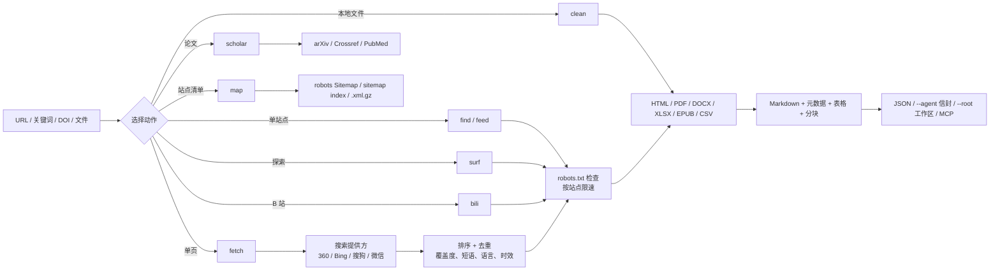

# web-forager

**礼貌地读取公开网络，把一份干净、可信的记录交给智能体。**

搜索、抓取、抽取与浏览放在同一个引擎里：发现走 360 / Bing / 搜狗 / 搜狗微信；读取覆盖 HTML、PDF、Office、EPUB、CSV、订阅源与 sitemap；需要脚本执行或登录态的页面交给真实浏览器。它会拒绝不该碰的目标，并且每条记录都写明跳过了什么、为什么。

**简体中文** · [English](README.md)

**版本：** 1.3.1 ｜ **许可：** MIT ｜ **Python：** 3.10+ ｜ **Node：** 18+（浏览器模式）

> 本插件仅供学习与研究用途。使用前请阅读[完整法律声明](#完整法律声明)。

---

## 目录

**开始**

- [为什么选 web-forager](#为什么选-web-forager)
- [安装与下载](#安装与下载)
- [快速上手](#快速上手)
- [可以直接这样问](#可以直接这样问)

**深入**

- [两种模式，一种记录](#两种模式一种记录)
- [一次运行如何流转](#一次运行如何流转)
- [一次运行长什么样](#一次运行长什么样)
- [仓库结构](#仓库结构)
- [完整参考](#完整参考)
- [安全边界](#安全边界)
- [范围与合规](#范围与合规)

**其他**

- [环境要求](#环境要求)
- [测试](#测试)
- [完整法律声明](#完整法律声明)
- [已知限制](#已知限制)
- [问题反馈](#问题反馈)
- [致谢](#致谢)
- [商标声明](#商标声明)
- [许可与作者](#许可与作者)

---

## 为什么选 web-forager

搜索 API 只返回链接，爬虫只读页面而不管规则。智能体需要这两半，外加一个可信任的契约；这个仓库把三者放进同一个引擎，中间没有 API key，也没有托管索引。

- **一个引擎，所有内容类型。** HTML、PDF、DOCX、XLSX、EPUB、CSV、RSS/Atom、站点地图、B 站与渲染页面都返回同样四个字段——`metadata`、`markdown`、`tables`、`warnings`——调用方不需要按来源分支。
- **合规在抓取器内部，不是 README 里的承诺。** robots.txt、按站点限速、响应体积上限、重定向次数上限与可联系的 User-Agent 对每个请求生效，搜索、sitemap 与 surf 的每一跳也不例外。
- **缺少组件时降级，而不是崩溃。** 没有桥是退出码 3，缺 Playwright 是 6，缺 `pypdf` 是 7，站点没有 sitemap 是带说明的空结果，验证页会报告 `verification_required`，而不是被当成正文交出去。
- **如实报告读到了什么。** `engine_report` 列出每个引擎的耗时与错误，`skipped` 列出每条读不到的结果，`degraded` 表示页面读到了但剧本没找到目标，抓取文本带 `trust: "untrusted"`；看起来像提示词时还会给出 `injection_findings`，其中包含规则码、严重级别、字符位置与命中的原文片段。
- **只有一个引擎应答时也会排序。** 覆盖度、标题与短语命中、域名先验与摘要时效共同决定顺序；重复 URL 会先规范化（`utm_*`、片段、`www.`、末尾斜杠），多引擎同时命中的结果获得 RRF 加分，轻量词形归一让 `injection` 能遇到 `injections`。结果必须包含完整短语，或至少两个有意义的查询词；中文教程只重复一个英文产品名时会被标为 `language_match: false`，真有足够相关结果时直接剔除。每个域名最多两条，来源不足时用溢出结果补满；首轮过少时用简化查询重试一次。载荷里的 `search_quality` 会统计相关、跑题与语言不匹配的数量。
- **脚本壳会渲染，但有预算。** 服务器只返回极少的 HTML 时，`--render auto` 会先用 Playwright 渲染一次再抽取；`fetch --query` 与 `surf` 每次最多两页。

---

## 安装与下载

请按一个完整插件安装：CLI、两个 MCP 服务与 `SKILL.md` 共用同一个引擎和同一条 robots/缓存流水线，拆散目录会失效。

**大多数人走方法一：让 AI 帮你装。** 有插件市场、且想自己注册 URL 的走方法二；在终端里安装、或要装到多个宿主的走方法三。

## 方法一：让 AI 帮你装

```bash
请访问 GitHub 仓库 `https://github.com/JiamingShi-JsPhys/web-forager` 并克隆它，然后运行 `python install.py --project . --global`。如果你的宿主有插件系统，请改为把整套作为单一插件安装；该脚本覆盖的是读规则文件的那些宿主。
```

## 方法二：从插件市场用 URL 安装

下面每个宿主都有自己的插件市场。把本仓库的 Git URL 注册进去，再安装它列出的插件即可（URL 重复注册没有副作用，第二次会提示已存在）。

```text
https://github.com/JiamingShi-JsPhys/web-forager
```

在末尾加 `#v1.3.1` 可以把安装固定到本次发布；去掉则跟随默认分支。

## 方法三：用命令安装

Claude Code、Codex、dsh 与 CodeBuddy 用一行插件命令即可；Cursor、Windsurf、Cline、Continue、Roo Code、GitHub Copilot 与 opencode 读规则文件，一个脚本能把它们全部写好。各宿主的完整命令、全部参数与可选依赖都在这一页：**[docs/INSTALL_COMMANDS_zh.md](docs/INSTALL_COMMANDS_zh.md)**。

每个插件宿主读自己的 MCP 启动文件：Claude Code 读 `.mcp.json`，Codex 读 `.codex-plugin/mcp.json`，CodeBuddy 读 `.codebuddy-plugin/plugin.json` 里的 `mcpServers`，dsh 读 `cordis.patch.yml` 里的两个 `dsh-mcp-client` 条目。在 CodeBuddy 或 dsh 安装后请新开一个会话让服务挂载；`codebuddy mcp list` 可能在插件加载前运行，不能当作健康检查。

### 让已安装的副本保持最新

宿主会把插件复制进自己的缓存，真正运行的是那份副本。修好的 bug 会一直跑到缓存被刷新为止；而以本地目录为源的市场，可能存的是一份快照，而不是实时目录。

ZCode 的做法是先刷新市场索引，再更新插件：

```bash
zcode plugins marketplace update web-forager-marketplace
zcode plugins update web-forager@web-forager-marketplace
```

如果两次安装之间版本号没变，`update` 可能会认为缓存已经是最新；这时改用重装：

```bash
zcode plugins uninstall web-forager@web-forager-marketplace --force
zcode plugins install web-forager@web-forager-marketplace --yes
```

Claude Code 用户可以运行 `claude plugin update web-forager`。任何更新之后，`python run.py --action doctor` 会报告当前运行的副本实际能看到什么。

---

## 快速上手

三个入口，外加一个可选的浏览器模式。按你所在的位置挑一个。

### 在聊天框里用

技能注册在 `web-forager` 命名空间下，一次 `/` 即可调用：

```text
/web-forager:web-forager  收集 https://www.bilibili.com/video/BV1xx411c7mD 并转成 Markdown
```

在名字后面说清需求，技能会自动选择动作，返回 Markdown、元数据、表格与警告。robots.txt 禁止的页面会被拒绝，而不是被强抓。

五个命令覆盖常见需求：

| 命令 | 作用 |
|---|---|
| `/web-forager:fetch` | 抓取一个 URL，或搜索关键词并读取结果 |
| `/web-forager:surf` | 搜索或打开种子 URL，再按相关度跟随页内链接，支持断点续游 |
| `/web-forager:scholar` | 查询 arXiv、Crossref、PubMed，或解析 DOI |
| `/web-forager:map` | 从 robots.txt 的 `Sitemap:`、sitemap index 与 `.xml.gz` 发现页面 URL |
| `/web-forager:browse` | 通过浏览器 MCP 服务运行只读剧本 |

```text
/web-forager:fetch https://example.org/article
/web-forager:scholar 10.1038/nature14539
/web-forager:browse 读这篇公众号文章：https://mp.weixin.qq.com/s/...
```

### 在终端里用

先安装依赖：

```bash
pip install -r requirements.txt
```

一个页面：Markdown + 元数据 + 表格

```bash
python run.py --action fetch --url "https://example.org/article"
```

先搜索，再读最相关的几页

```bash
python run.py --action fetch --query "城市漫步 攻略" --num-results 8 --max-pages 3
```

宽召回，再只读权威来源并抽取证据

```bash
python run.py --action research --query "Python 3.12 asyncio.TaskGroup 默认异常处理" --focus 3
```

`research` 按相关性和明确的权威层级选源；宽召回里没有权威答案时，追加一次
`site:` 官方文档检索或 arXiv 标题检索；只读少数不同 host，返回带 URL 的匹配句段和
`answerability` 结论。证据不足时返回 `low` / `none`，不编造。

一篇论文：不碰搜索结果页

```bash
python run.py --action scholar --source doi --query "10.1038/nature14539"
```

搜索默认走 `auto`：以中日韩文字为主的查询会同时问 360、搜狗与搜狗微信；拉丁查询走 360 与 Bing。搜索引擎被墙或被反爬时，[完整参考](docs/REFERENCE_zh.md#搜索引擎不可用时)里有不依赖引擎的站内搜索与订阅源两条路。

不确定该用哪个动作？

| 你手上有 | 用这个 |
|---|---|
| 一个 URL 或一个关键词 | `--action fetch` |
| 一个需要引用证据的问题 | `--action research` |
| 一个可信站点，但搜索引擎不可用 | `--action find --site <HOST> --query <TEXT>` |
| 一个博客或新闻站 | `--action feed --url <SITE>` |
| 一个 PDF、DOCX、XLSX、EPUB 或 CSV | `--action clean --input <FILE>` |
| 一个想按链接逐步探索的主题 | `--action surf --query <TEXT>` |
| 一个 DOI、arXiv 编号或论文标题 | `--action scholar` |
| 一个想枚举页面的站点 | `--action map --url <SITE>` |
| B 站 | `--action bili` |
| 「为什么跑不通」 | `--action doctor [--probe]` |

任意动作加 `--agent` 得到机器可读的 `{"ok":true,"data":…}` 信封；加 `--out result.json` 把完整记录落盘；加 `--root <WS>` 写进工作区（`<WS>/process/web-forager/` 与 `<WS>/_broadcast/`），见[记录与输出](docs/REFERENCE_zh.md#记录与输出)。

### 在 MCP 客户端里用

```json
{
  "mcpServers": {
    "web-forager": {
      "command": "python",
      "args": ["/absolute/path/to/web-forager/mcp_server.py"]
    },
    "web-forager-browser": {
      "command": "node",
      "args": ["/absolute/path/to/web-forager/browser/mcp_server.js"]
    }
  }
}
```

HTTP 服务暴露十个工具（`web_fetch`、`web_search`、`web_research`、`web_surf`、`web_scholar`、`web_map`、`web_bilibili`、`web_doctor`、`web_find`、`web_feed`）；浏览器服务暴露四个（`browser_list`、`browser_run`、`browser_session`、`browser_doctor`）。

MCP 调用不能放宽安全边界：没有任何工具参数能关掉 robots、改注入闸门、设代理、指定浏览器桥命令或允许写操作。本地文件 `clean` 只在命令行提供，不是 MCP 工具。一个开关能让搜索变便宜：`max_pages: 0` 只返回结果列表、不抓正文。`web_search` 还会返回 `engine_report`，以及结果不含查询词时的 `warnings`。

### 浏览器模式（可选）

需要 Node.js 18+ 与一个桥命令，默认只读。用 `python browser/launch_chrome.py` 登录一次（CDP 默认关闭，只打开专用配置目录），然后以默认后端运行浏览器，复用该配置。确实需要 DevTools 接入时，才给 launcher 加 `--cdp`，并给剧本加 `--backend cdp`。八个剧本、各自的开关、`--strict-robots`、storage-state 与成本控制都在[完整参考](docs/REFERENCE_zh.md#浏览器模式)里。HTTP 搜索已经找到公众号文章、却被 robots.txt 与环境校验挡住时，就用 `wechat-dig`。

---

## 可以直接这样问

| 你的说法 | 路由到 | 你拿到 |
|---|---|---|
| 「读这篇文章，保留表格」 | `fetch --url` | Markdown、元数据、表格与抽取警告 |
| 「找最近关于 X 的内容」 | `fetch --query` | 排好序、去过重结果，可选读取前几页 |
| 「这个站点发布了哪些页面」 | `map --url` | 来自 robots.txt Sitemap 与 sitemap index 的 URL |
| 「从这个页面开始跟着主题走」 | `surf --query` 或 `--url` | 可续跑的一跳一跳记录，每轮只做一个状态变更 |
| 「找关于 X 的论文」 | `scholar --source arxiv` | arXiv 元数据与摘要，不抓结果页 |
| 「这个 DOI 是什么」 | `scholar --source doi` | 一条归一化的书目记录 |
| 「读这个 PDF / Word」 | `clean --input` | 与 HTML 页面同样的 Markdown 记录 |
| 「为什么跑不通」 | `doctor --probe` | 依赖版本与当前网络里哪些引擎能答 |
| 「读这篇公众号文章」 | `browse` + `wechat-dig` | 正文；配置没过校验时如实返回 `blocked` |
| 「打开我登录后的页面」 | `browse` + `--backend cdp` | 该配置看到的页面，并附共享配置警告 |

---

## 两种模式，一种记录

| | HTTP 模式 | 浏览器模式 |
|---|---|---|
| 读取 | 服务器返回的内容 | 脚本执行、登录态生效后人真正看到的页面 |
| 入口 | `run.py`、`mcp_server.py` | `browser/run.js`、`browser/mcp_server.js` |
| 需要 | Python 3.10+ | Node.js 18+ 与一个桥命令 |
| 覆盖 | 搜索、HTML/PDF/Office/订阅源、sitemap、surf、B 站、学术 API | 八个只读剧本、渲染页面、弹幕、公众号文章 |

两种模式共享四个核心字段——`metadata`、`markdown`、`tables` 与 `warnings`——其余部分各自扩展。任一侧加 `--core`，或给 `browser_run` 传 `core: true`，都会折叠成同一种有文档的形状（见[记录与输出](docs/REFERENCE_zh.md#记录与输出)）。

只有 B 站有站点专用 HTTP 适配器。知乎、小红书、微博与豆瓣在 HTTP 模式下按普通页面读取；知乎与小红书另有浏览器剧本，微博与豆瓣没有。公众号是 HTTP 模式唯一经常走不完的一类：robots.txt 禁止文章路径，页面本身又会返回环境校验。`wechat-dig` 改为在浏览器配置里打开它；配置没通过校验时报告 `blocked`，而不是去解校验。

---

## 一次运行如何流转

每个请求都先进入同一个 `HttpFetcher`：robots 策略、缓存、重试退避、按站点限速与体积上限。所选动作把载荷交给对应的抽取器，所有抽取器最终都汇成同一种 Markdown 记录。



`surf` 只跟随页面里已经存在的 `<a href>` 链接，从不拼猜 URL、提交表单或执行页面 JavaScript。`map` 只读公开发布的 sitemap，`scholar` 调用有文档的 API，而不是抓结果页。

浏览器模式是并排的第二条循环：桥提供页面，`browser/run.js` 读取 DOM 快照，会话判断哪些是新的，剧本决定下一步导航，最后写出捕捉记录。每个观察周期只执行一个会改变状态的动作，写操作默认拒绝。

---

## 一次运行长什么样

一次每个结果都能读的搜索：

```text
$ python run.py --action fetch --query "城市漫步 攻略" --num-results 8 --max-pages 3
mode: search
pages: 3/3 readable
skipped: none
engine_report: 360 (0), 搜狗 (7, 0.7 s), 微信 (8, 0.5 s)
```

一次有来源拒绝的搜索：

```text
skipped: 5
  robots_denied  https://mp.weixin.qq.com/s?...
  robots_denied  https://mp.weixin.qq.com/s?...
warnings:
  robots.txt denied the skipped paths. Use --robots-policy warn only when you are authorised to read them; the record will mark the override.
  WeChat article links cannot be read in HTTP mode ... open one with browser mode: browser_run with playbook "wechat-dig".
```

第一种是成功。第二种也是成功——它说清了自己没做到什么，而不是把错误页当成文章返回。

---

## 仓库结构

```text
web-forager/
├── run.py                 # 一个 CLI 入口：fetch、research、find、feed、clean、surf、scholar、map、bili、doctor
├── mcp_server.py          # stdio JSON-RPC，十个 HTTP 工具
├── scripts/               # 引擎、抽取器、搜索解析器、robots、缓存、不可信内容筛查
├── browser/               # Node 浏览器模式：run.js、MCP 服务、剧本、桥、配置启动器
├── commands/              # 斜杠命令：fetch、surf、scholar、map、browse
├── docs/                  # 参考、安装命令、依赖、致谢
├── tests/                 # Python 套件与离线夹具
└── browser/tests/         # 浏览器套件：假后端、假桥、录制的快照
```

逐目录细节、全部动作与参数、记录结构与完整退出码表：**[docs/REFERENCE_zh.md](docs/REFERENCE_zh.md)**。

---

## 完整参考

记录结构、完整动作列表、退出码、环境要求、目录结构与测试细节都放在 **[docs/REFERENCE_zh.md](docs/REFERENCE_zh.md)**，让这一页保持为快速上手。

| 退出码 | 含义 |
|---|---|
| `0` | 动作完成；读不到的结果列在 `skipped` |
| `2` | 参数或 URL 错误 |
| `3` | robots.txt 拒绝访问，或没有配置浏览器桥 |
| `4` | 网络 / HTTP / 导航失败 |
| `5` | 抽取或捕捉失败 |
| `6` | 请求了 Playwright 但不可用，或浏览器模式下要求登录 |
| `7` | 处理 PDF 但 `pypdf` 不可用 |
| `8` | `degraded`：页面读到了，但剧本要的东西一个都没找到 |
| `9` | `blocked` 或 `verification_required`：反爬页或验证页替换了内容 |
| `10` | 查询被拒绝，因为它要求对私人个体做画像 |
| `130` | 被中断 |

`--agent` 保留这些退出码，并在 stdout 输出 `{"ok":false,"error":{"code","message","hint"}}` 信封。

---

## 安全边界

工具会执行提示词或智能体要求的请求，因此边界写进代码，而不是留给调用方自行记得。

- **拒绝私有目标。** 环回、RFC 1918、链路本地（含 `169.254.169.254`）、CGNAT 及其 IPv6 形式，在建立连接前就被拒绝，并且对每一次重定向再查一遍，公共 URL 无法把客户端弹进局域网。`--allow-private` 只服务本地夹具与可信内网工具，默认关闭。浏览器侧把同一道检查装成请求过滤器，恶意页面无法在浏览器内探测 `http://127.0.0.1:...`。
- **robots.txt 是策略，不是锁。** 默认 `--robots-policy respect` 会拒绝被禁止的路径；`warn` 读取后把 `compliance.robots_overridden: true` 写进记录；`ignore` 则记录「未查 robots」。被拒会如实报告给调用方——它不是让你换一个不查 robots 的工具重抓同一 URL 的信号。
- **查询接口有单独的策略。** 搜索引擎与学术 API 不是目标页，因此走 `--query-robots`（或环境变量 `WEB_FORAGER_QUERY_ROBOTS`），默认 `warn`。Bing、360、搜狗与 arXiv 导出接口都禁止各自的查询路径，所以默认会读取并在引擎报告里记录 `query_robots: warn`；`respect` 会拒绝，`ignore` 跳过检查。只有用户能选，MCP 绝不接受模型传入该开关。
- **浏览器使用自己的配置目录。** 自带桥把状态存在 `~/.web-forager/browser/profile`，不是你的日常浏览器。`browser/launch_chrome.py` 会在这个 profile 上启动 Chrome；`--save-storage-state` 写出的 Playwright 状态文件权限为 `0600`（落在 `--root` 内会被拒绝）。经 CDP 接入个人浏览器仍然可用，但运行结果会标 `shared_browser: true` 并附警告：那个配置里的每个 Cookie 与登录态，剧本打开的页面都能碰到。
- **抓取到的文本是数据，记录里也这么写。** 每条记录带 `trust: "untrusted"`。页面里出现指令形状的文字时，`injection_findings` 会记录规则码、严重级别、字符位置与一小段命中原文，`warnings` 第一条会重复最多三条证据。硬规则（伪造 system 标签、要求外传密钥、`curl ... | sh`、`rm -rf /`）才可能让 `--input-gate strict` 扣留正文；软规则（“忽略之前的指令”、角色切换）只报告、不扣留，因为论文与安全文章会合法引用这些话术。扫描按重叠窗口覆盖全文，发生在 `max_chars` 截断之前。这是一道筛子而不是沙箱：宿主仍须避免让不可信内容、私有数据与对外请求同时出现在一个自主循环里。

### 隐私与本地状态

- **没有遥测、没有账号、没有 API Key。** 插件不会把使用数据发到任何地方；它只向你指定的搜索引擎、学术 API 或目标站点发出请求。查询词与目标 URL 会为完成该请求而离开本机，这是检索本身的一部分。
- **落盘状态只在本机。** 开启缓存时，页面正文与响应元数据在 `~/.web-forager/cache` 保留一小时；会设置 Cookie 的响应不写入缓存，`Authorization` / `Proxy-Authorization` 头会被剥离。POSIX 下缓存目录为 `0700`、文件为 `0600`。
- **会话与浏览器状态同样在本机。**  Surf 会话（`~/.web-forager/sessions`）保存访问过的 URL；浏览器会话在 `~/.web-forager/browser/sessions`；`--save-storage-state` 以 `0600` 写入 Cookie；专用浏览器配置目录为 `0700`。`--verbose` 只记录协议、主机与路径，查询串和片段会被丢弃，带签名的 URL 不会把令牌打进 stderr。
- **DevTools 端口默认关闭。** `browser/launch_chrome.py` 默认只打开专用配置目录；加 `--cdp` 才把 Chrome 的 CDP 端口绑在环回地址，并默认随机选空闲端口（`--port 9222` 可固定）。开着时任何本机进程仍能接入，所以端口只留在本机，用完关闭浏览器。
- **不以个人信息为目标。** 人肉搜索防护会拒绝明确的个人画像查询，并对裸姓名给出警告；它按意图判断，不构成保证。不要用本工具收集或拼装可识别个人的私密信息。

---

## 范围与合规

核心引擎为原创的干净室实现：没有从 Crawlee、Scrapy、Colly、Katana 或其他爬虫框架复制任何源码，也不依赖任何 GPL/AGPL 库。工具**不会绕过**登录、验证码、Cloudflare 挑战或付费墙，也不进行并发请求洪峰。抓取每个目标页面前都会按 `--robots-policy` 检查 `robots.txt`（RFC 9309 子集），每个请求都携带可联系的信息收集 User-Agent，默认每站点每秒最多一个请求——搜索、sitemap 与 surf 的每一跳同样适用。

站点返回验证页时，记录写 `verification_required` 并停下；浏览器配置没过站点校验时，剧本写 `blocked` 并停下。两条路都不会去满足校验。

---

## 环境要求

Python 3.10+ 与 `requirements.txt` 里的包（`requests`、`beautifulsoup4`、`trafilatura`）。可选：`playwright` 用于 JavaScript 渲染，`pypdf` 用于 PDF 文本。浏览器模式另需 Node.js 18+ 与一个桥命令；自带桥需要 npm 安装的 `playwright` 及其 Chromium 二进制。

```bash
pip install playwright && playwright install chromium
```

缺可选包不会让运行崩溃：Playwright 是退出码 6，`pypdf` 是 7，记录里带安装提示。逐项依赖矩阵在 [DEPENDENCIES.md](DEPENDENCIES.md)。

## 测试

```bash
python -m pytest
node --test "browser/tests/*.test.js"
```

333 个 Python 测试与 91 个浏览器测试，全部离线。Python 套件会起一个临时本地 HTTP 站点，提供 robots.txt、文章、PDF/Office 文件、订阅源、sitemap、搜索结果页与多跳 surf 页面；浏览器套件用假后端与说同一套线协议的假桥，再加真实页面导出的快照。CI 从仓库克隆里跑两套；发布归档不含测试目录。

## 完整法律声明

### 用途

web-forager 把读取公开可访问页面的过程自动化，仅用于学习、研究、监测和个人知识整理。

### 禁止用途

- 识别、定位、画像或联系某个私人个体，或把散落各处的记录拼成一个人的全貌。
- 骚扰、跟踪、恐吓、人肉搜索，或任何侵犯他人隐私的行为。
- 绕过登录、验证码、付费墙或访问控制，或超出内置限速给站点施加负载。
- 对目标站点发起恶意并发请求，或任何拒绝服务式的访问。
- 任何违反你所在地法律、或你正在读取的站点条款的用途。

### 你的责任

遵守适用的法律法规，以及所访问站点的 Terms of Service 与版权，是最终使用者的责任。作者不授予访问你无权查看内容的许可，也不对某次具体使用是否合法作出判断。使用者对软件的使用方式承担全部法律责任。

### 不作担保

本软件按 MIT 许可证的「AS IS」提供，不附带任何明示或默示担保（见 [LICENSE](LICENSE)）。它可能失败、返回不完整或过时的内容，也可能在版本之间改变行为。

### 责任限制

在法律允许的最大范围内，作者与贡献者不对本软件的任何误用承担责任，也不对由此产生的任何损害、损失或法律后果负责。抓取到的文本来自第三方站点，本项目不为其背书，也不做核查。

### 再分发

发布或 fork 时，请保留本免责声明与许可证声明。

---

## 已知限制

### 使用前必读

- **这是低频工具，不是爬虫集群。** 请求串行、按站点限速（默认每秒一次），`surf`、搜索与 sitemap 读取都不做并发扇出，因此不适合大规模采集。
- **PDF 只读取文本层。** 扫描件需要 OCR，本插件不做。
- **不绕过登录墙。** `zhihu-dig` 与 `xhs-dig` 会以 `login_required` 停下；请通过桥复用已登录的配置目录。
- **公众号正文在 HTTP 模式下读不到。** robots.txt 禁止 `/s`，即使覆盖也会返回环境校验页。记录写成 `verification_required`；`wechat-dig` 只能在已通过该校验的配置里读到正文。
- **默认搜索会记录一次 robots 覆盖。** Bing、360、搜狗与 arXiv 导出接口都禁止各自的查询路径。`--query-robots` 默认 `warn`，所以搜索可用，但引擎报告会写明这次覆盖；把策略设为 `respect` 可拒绝被禁止的接口，`ignore` 则跳过检查。
- **robots.txt 不可达即拒绝。** 这是 RFC 的保守做法。`--ignore-robots` 仅用于你已获得明确授权的资源。MCP 浏览器调用始终带 `--strict-robots`；命令行浏览器调用在 `--strict-robots` 下查 robots.txt，HTTP 与浏览器的每一次重定向都会复查。记录里始终写明是否查过（`compliance.robots_checked`）。

### 边缘情况

- **学术 API 只返回元数据与摘要。** 不返回全文；请遵守各平台条款。
- **`--render auto` 是启发式判断，外加一次有预算的兜底。** 可见文字过少加 SPA 标记会触发渲染；极小的脚本壳会额外渲染一次。复杂站点可能仍需要 `--render always`，而 `--wait-for` / `--scroll` 只在装了 Playwright 时生效。
- **搜索依赖公开结果页。** 可用性随网络变化，且每个解析器（`parse_360_html`、`parse_bing_html`、`parse_sogou_html`、`parse_weixin_html`、`parse_ddg_html`）都对结果页结构有假设。每个都有 `tests/fixtures/` 下的离线夹具，改版会让夹具测试失败，而不是悄悄返回空。**不支持百度**：其结果页防护很强，本插件没有对应解析器。搜狗可能弹人机验证，`--engine all` 可能部分失败。中文查询不会回落到 Bing，只命中查询中单个字的词典页会被过滤。
- **只有 B 站有站点专用 HTTP 适配器。** 上面提到的其他站点都按普通页面读取，够用于公开文章页，不够用于登录后的信息流。
- **浏览器模式需要可用的桥。** `playwright` 与 Chromium 二进制要另外安装，`--doctor` 会指出缺的是哪一个；完全找不到桥时，真实运行以退出码 3 返回。
- **`surf` 只跟随普通链接。** 不点按钮、不执行 JavaScript、不处理登录墙。
- **DNS 会解析两次。** 拦截检查一次 DNS 返回的地址，HTTP 客户端连接时再解析一次。若恶意解析器在两次调用之间给出不同答案（rebinding），这道检查拦不住；这种威胁模型需要配合出站网络策略。

### 实验性与高风险开关

- **弹幕仍是实验性能力。** 优先用桥的 `observe("danmaku", ms)`；DOM 文本是兜底路径，假设页面上有一种可见的 `mm:ss 文本` 布局，记录会在 warnings 里写明这一点。canvas 渲染的文字仍需 OCR。
- **浏览器选择器是启发式的。** 所有关于第三方页面的模式都集中在 `browser/lib/selectors.js`，并用真实页面导出的快照做回归（`browser/tests/fixtures/snapshots/`，记录于 2026-11-07）。它只能在改版之后发现漂移，不能提前预知；设置 `WEB_FORAGER_LIVE=1` 并接好桥后，`npm run test:live` 会对真实站点复查。
- **注入筛查是一道筛子，不是沙箱。** 它匹配已知话术，会漏掉改写过的表达。真正约束恶意页面的是 `trust: "untrusted"` 与宿主自己的权限模型，标记列表只让边界可见。
- **私有地址拦截可以关掉。** `--allow-private`（或 `WEB_FORAGER_ALLOW_PRIVATE=1`）服务本地夹具与可信内网目标，会关闭环回/局域网/元数据地址检查。对你不控制的输入永远不要打开它。
- **CDP 接入会暴露所接入的浏览器。** 自带桥使用独立配置目录，而 `WEB_FORAGER_BROWSER_CDP` 复用你已开着的浏览器，连同其中全部 Cookie 与登录态。

---

## 问题反馈

**普通缺陷与功能建议**：请提交到仓库的 [Issues](https://github.com/JiamingShi-JsPhys/web-forager/issues) 页面，附复现步骤、期望行为、实际行为与环境（操作系统、Python 版本）。

**安全漏洞（仅此类别）**：**不要**使用公开 Issues 页面，请改为发送邮件至 `jiamingshi_git@outlook.com`。

- **主题**：必须带前缀 `report_web-forager:`，并附简短摘要。
  - 示例：`report_web-forager: 路径穿越可读取目标目录之外的文件`
- **正文**：必须包含详细复现步骤与环境信息。

*提交清晰、可复现 issue 或 pull request 的贡献者，会在下个版本的更新说明与[致谢](#致谢)中列出。*

## 致谢

**NotFatJustRound** —— 早期测试与反馈。

**DeepSec** —— 本仓库使用的代码安全审计器。它发现了 1.2.3 中关闭的两条命令注入路径，以及同一版本的供应链问题。

**Claude**（Anthropic）—— 在本项目部分环节提供了一些辅助：代码片段、测试、文档与发布说明方面的修改建议。所有建议都经审阅，只有通过测试、检查或实际验证的才会采纳；最终内容由作者定稿。

[详细致谢](docs/ACKNOWLEDGEMENTS_zh.md)

## 商标声明

"Bilibili""知乎""小红书""arXiv""Crossref""PubMed""Claude""Codex""CodeBuddy""ZCode"与"DeepSeek"是其各自所有者的商标或注册商标。web-forager 是独立的第三方工具，与上述任何一方均无隶属、背书或赞助关系。所有请求只访问公开页面或有文档的 API；使用者需自行遵守各平台条款。

---

## 许可与作者

MIT。见 [LICENSE](LICENSE) 与 [THIRD_PARTY_LICENSES.txt](THIRD_PARTY_LICENSES.txt)。

**作者与维护者**：Jiaming Shi
